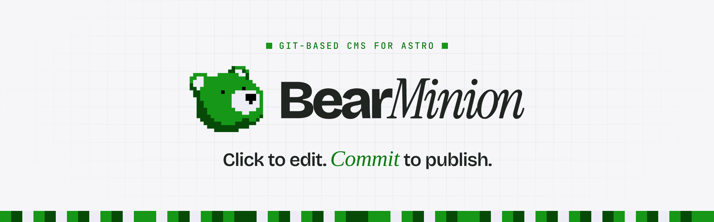
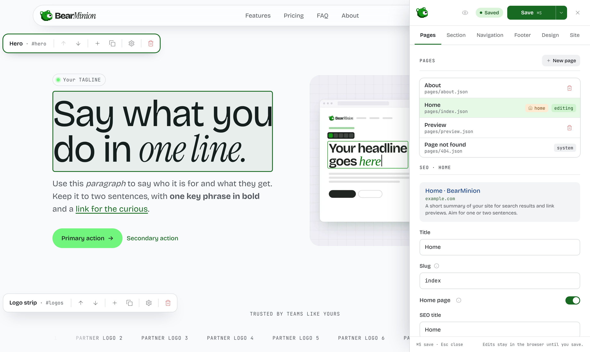
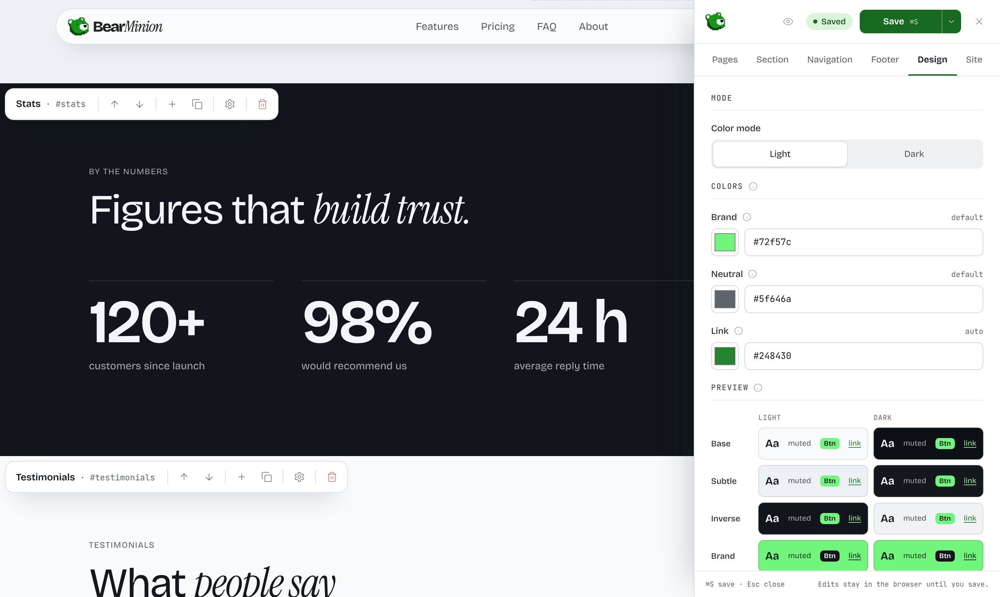

<p align="center">
  
</p>

<p align="center">
  A website you edit by clicking on it. No database, no admin panel, no server.<br />
  Built on <a href="https://astro.build">Astro</a>.
</p>

<p align="center">
  <a href="https://github.com/langehelp-software/bearminion/actions/workflows/ci.yml"></a>
  <a href="https://www.npmjs.com/package/bearminion"></a>
  <a href="LICENSE"></a>
</p>

## Quick start

You need [Node.js](https://nodejs.org) 22.12 or newer.

**1. Create your site**

```bash
npm create bearminion@latest my-site
cd my-site
npm run dev
```

It asks for the site's name and web address, then installs everything and makes the first git commit. Add `--storybook` for a component workshop, or see [all options](packages/create-bearminion/README.md#options).

**2. Edit it**

Open the address it prints (usually http://localhost:4321) and press **Ctrl+E** (**Cmd+E** on a Mac). Click any text to change it, hover a section to move, add or remove it, and use the sidebar for pages, menus, colors and images. Press **Ctrl/Cmd+S** to save.

**3. Put it online**

Push the folder to a GitHub repository and import it in [Vercel](https://vercel.com/new), [Netlify](https://app.netlify.com/start) or [Cloudflare Pages](https://pages.cloudflare.com). Vercel and Netlify detect Astro on their own; on Cloudflare Pages, pick the Astro preset. Before you share the link, set your address under **Site → URL** in the editor, so search engines and link previews point to it.

From then on: edit, save, commit, push. The site rebuilds by itself.

<p align="center">
  
</p>

## What you can change

- **Text** right on the page, with bold, italic, links and lists
- **Sections**: eleven ready-made types (hero, features, pricing, video, FAQ, contact and more), each with three layouts
- **Pages**: create, rename, choose the home page, set titles and descriptions for search and sharing
- **Menus and footer**: drag to reorder and nest
- **Images**: upload, choose how they fill their frame and which part stays in view
- **Colors**: pick three, and the editor builds a full light and dark palette that stays readable

<p align="center">
  
</p>

Your content is plain files in your project, so every change is in your git history and nothing can lock you in. The editor only exists on your computer: the published site is fast, static HTML.

## Learn more

- [Documentation](docs/README.md): the content files, the editor, building your own theme, and the API
- [Template guide](templates/default/README.md): the components that come with your site
- [Contributing](CONTRIBUTING.md) · [Security](SECURITY.md) · [Code of Conduct](CODE_OF_CONDUCT.md)

## License

[MIT](LICENSE) © Jakub Lange
