The editor is an overlay on your own site. You edit the page where it is, and a shell around it holds everything that is not on the page: a navigation on the left, a top bar, an inspector on the right, and full-screen views for your content, media and settings. Nothing reaches your files until you save.

This page describes the editor on your computer, in `astro dev`. The same editor can run at a web address where people sign in with GitHub: see [Edit online](hosted-editor.md), which also lists [what differs there](hosted-editor.md#what-differs-from-the-editor-on-your-computer).

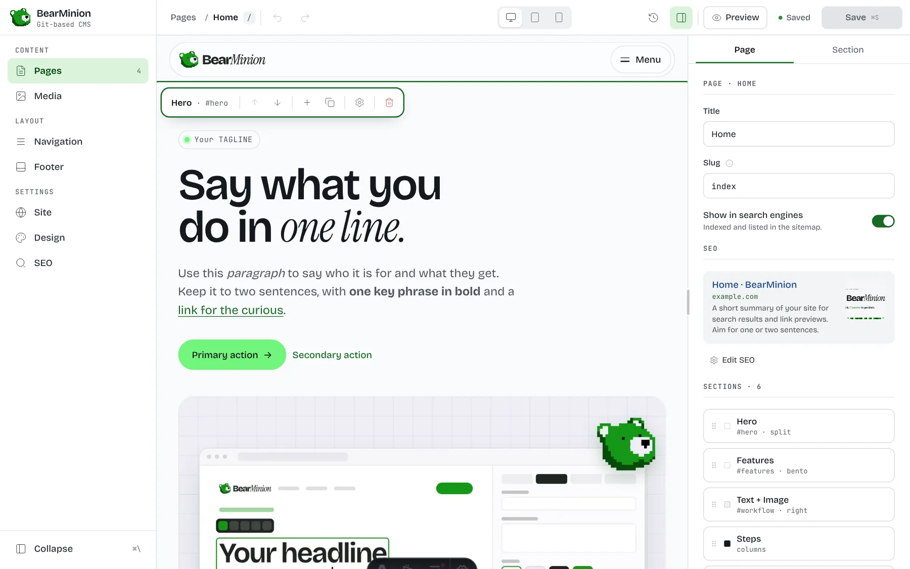

On this page:

- [Open the editor](#open-the-editor)
- [Edit text on the page](#edit-text-on-the-page)
- [Edit sections](#edit-sections)
- [The editor shell](#the-editor-shell): [the navigation](#the-navigation), [the top bar](#the-top-bar), [the inspector](#the-inspector), [content listings](#content-listings), [Media](#media) and the settings screens: [Navigation](#navigation), [Footer](#footer), [Design](#design), [Site](#site) and [SEO](#seo)
- [Images](#images)
- [Preview](#preview)
- [Save, drafts and history](#save-drafts-and-history)
- [Keyboard shortcuts](#keyboard-shortcuts)

## Open the editor

Run `npm run dev` in your site (`pnpm dev` from the root of the BearMinion repository) and open it in the browser. The editor frames the page: it sits below the top bar, between the navigation and the inspector, and scrolls on its own. The site's sticky header sticks to the top of that frame, and its media queries still see the whole window, as before. Ctrl+E or Cmd+E opens and closes the inspector.

## Edit text on the page

Click any text marked `data-field` and type. Enter commits a single-line field. Pasting into a plain field pastes plain text.

### Headings and the site name

Select words in a heading or in the site name to open the format bar. It sets weight (400, 500, 600, 700) and font (sans, serif, mono) for the selection.

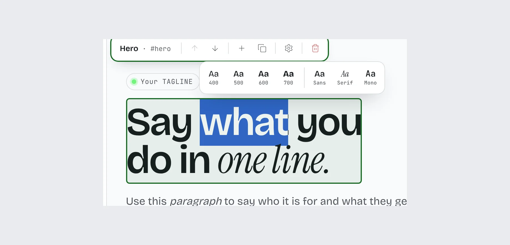

Replacing a heading keeps inline marks aligned with the new text. A mark is dropped when its word is gone.

### Formatted text

Fields whose path ends in `body`, `intro`, `sub`, `description`, `quote`, `note`, `thanks` or `a`, list items under `points`, and any field with `data-field-kind="rich"` are edited as formatted text.

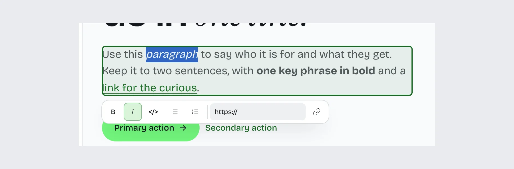

| Control | Result |
| --- | --- |
| Bold, italic, code | `**bold**`, `*italic*`, `` `code` `` |
| Link | `[text](url)`. Add `{new}` or `{same}` so the new-window choice round-trips |
| Bulleted or numbered list | `- item`, `1. item` |
| Enter | In a list, starts the next item. On an empty item, leaves the list. Elsewhere, a line break |

The stored value is Markdown, with blank lines for paragraphs. Text in backticks is literal: nothing inside it is parsed.

Headings are fields, and images are [image slots](#images). Rich-text fields have no heading buttons, with one exception: a field the theme marks with `data-rich-headings="true"` (the starter's Text section) adds **H2** and **H3** buttons to the toolbar. They write `## heading` and `### heading` on their own line. Enter at the end of a heading starts a paragraph, and Shift+Enter does nothing in one. Pasted `h1` to `h6` become H2 or H3 there, and are dropped everywhere else.

#### What the starter renders

The starter renders that Markdown as `strong`, `em`, `code`, `a`, `br`, `p`, `ul` and `ol`, and escapes every other character.

- `javascript:`, `data:` and `vbscript:` URLs are dropped.
- `http` and `https` links get `target="_blank"` and `rel="noopener noreferrer"`, unless `{same}` is set.
- Pasted HTML is parsed with `DOMParser`, read back as that Markdown subset and rendered again. Images, attributes and event handlers from the clipboard are dropped, and so are headings in a field that has none.

### Links and buttons

Click a link or button on the page to open a popover for the label, the URL and “Open in new window”. Buttons and call-to-action links also take an optional HTML id. Optional buttons have a Remove action.

## Edit sections

Hover or select a section to outline it and show a toolbar on its top edge.

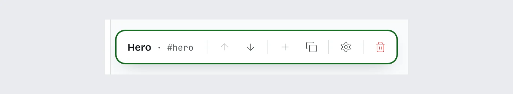

| Control | What it does |
| --- | --- |
| Name | The catalog label plus the anchor, such as `Pricing · #pricing`. Truncated, with the full text in a tooltip |
| Move up, move down | Disabled at the ends |
| Add | Opens “Add above” and “Add below”, then the section-type list |
| Duplicate | Asks for confirmation, then changes the draft |
| Settings | Opens the [Section tab](#section) of the inspector for this section |
| Delete | Danger style. Asks for confirmation, then changes the draft |

The toolbar stays visible while the section is in view. When the section top scrolls past, it pins under a sticky site header until the section ends. It does not cover the next section's toolbar. Escape cancels a confirmation and Enter confirms it.

## The editor shell


### The navigation

The left column has four groups:

| Group | Items |
| --- | --- |
| Content | **Pages**, then one item for every multi content type the site declares (see [Content types](content-types.md)), then **Media** and **[History](#history)**. Each content item shows how many documents it has |
| Layout | **Navigation**, **Footer** |
| Settings | **Site**, **Design**, **SEO** |
| Developer | **[Site status](#site-status)** |

An item opens its [full-screen view](#full-screen-views) over the page. On the page, the content type of the open document is highlighted. **Collapse** at the bottom (Ctrl+\\ or Cmd+\\) turns the column into an icon rail with a tooltip on each icon. The choice is kept in `localStorage` as `bearminion:shell-nav-open`.

### The top bar

On the page, the left side shows where you are: the content type (it opens that listing), the document's title and its address. Undo and Redo follow, the same as Ctrl/Cmd+Z and Shift+Ctrl/Cmd+Z. In a full-screen view the left side is a **Back to** button and the view's name instead.

In the middle, the [viewport switch](#viewport) picks Desktop, Tablet or Mobile. The right side has:

- **History**, a popover with this tab's undo steps and the repository's commits. See [History](#history).
- **The inspector button**, which shows or hides the inspector (Ctrl/Cmd+E).
- **Commit changes**, with the number of changed files, when [git](#git) is on.
- **Preview** ([details](#preview)).
- **Saved**, or **Unsaved · N changes**, which opens the list of changes with Save and Discard.
- **Save** (Ctrl/Cmd+S). It is greyed out while there is nothing to save.

Below 1180px of window width Preview shows its icon only, and below 1000px the viewport switch and the content type are hidden.

### The inspector

The panel on the right edits the open document. It has two tabs, **Page** and **Section**.

It starts at 352px. Drag its left edge, use the arrow keys on it (16px a step, Home and End for the limits), or double-click it to reset. The width stays between 280px and 560px and is kept in `localStorage` as `bearminion:inspector-width`. It starts closed in a window narrower than 1100px, and closes once when the window shrinks past that. Whether it is open, and which full-screen view is up, survive a reload, so a save brings you back to the same place.

#### Page

**Title and slug.** A rename is applied on save. The home page is a fixed page at `/`: it has no slug to change and no other page can take its place, so to change what visitors see first, edit its sections. A new page's slug is made from its title as you type it (accents are dropped, so `Łódź` becomes `lodz`, and an existing slug gets a number), until you edit the slug yourself. Changing a title later never changes the slug. A site whose addresses must not change can lock this with `pages: { rename: false, delete: false }` in the `bearminion()` options: the slug field becomes read-only and Delete is hidden. Creating pages and editing their content still work. See [Integration](integration.md).

**Status.** Published or Draft. A draft is left out of `astro build`, the listings and the sitemap, and still shows in `astro dev` and the editor. Published is the default and is stored as no `status` at all, so files from before this setting read as published. The home and 404 pages, singles and listing pages are always published. A content type with its own `draft` field keeps using that field instead.

**Show in search engines.** The opposite of the page's `seo.noindex`. The 404 page is always left out.

**Fields.** When the document belongs to a content type with fields of its own (a post's date, excerpt and cover), they follow. An optional field you empty is removed from the file.

**Sections.** The page's sections in order. Click a row to open it on the Section tab. Hover a row for move up, move down, duplicate, settings and remove, or drag it by its grip. **Add section** opens the section picker.

##### SEO

The SEO card shows the page as a search result, with the social image as a square thumbnail and badges for what is set (noindex, nofollow, canonical, JSON-LD). Problems with `seo.*` fields are listed on the card.

**Edit SEO** opens a dialog.

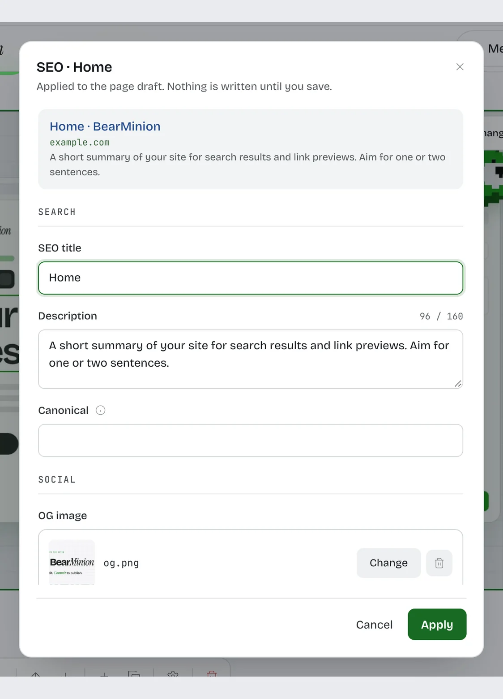

| Field | Notes |
| --- | --- |
| SEO title | Falls back to the page title and the site's title template |
| Description | With a character count |
| Canonical | Optional |
| OG image | The same [image field](#images) as everywhere else |
| noindex, nofollow | Switches |
| JSON-LD | An object, an array, or a pasted `<script type="application/ld+json">` tag. A Format button tidies it. A missing `@context` or `@type` is a warning |

Apply is blocked while the JSON is invalid. The dialog edits a copy: Apply writes one undo step, Cancel or Escape drops the edits. The page scroll is locked behind the dialog without shifting the layout.

#### Section

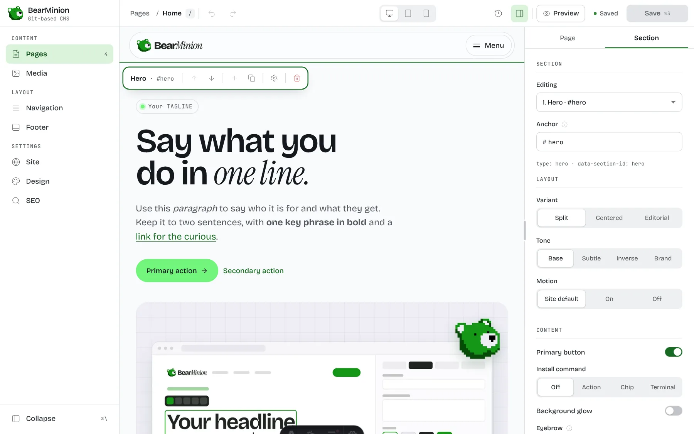

The tab has three groups, top to bottom:

1. **Section.** The section picker and the anchor.
2. **Layout.** Variant, tone, motion (Site default, On or Off), and top and bottom spacing (None, Half or Full of the section's own padding). Spacing shows only when the theme renders it: its sections carry `data-space-top` (see [Custom sections](custom-section.md)).
3. **Content.** The other options and every prop.

Choices with up to four values are segmented controls, longer lists are selects, and a field with icons (a step's icon) is an icon grid. Props the current options do not use are hidden, such as the poster while a Media section shows an image. Their values stay in the file.

**Anchor.** A lowercase slug, unique on the page. It is suggested from the heading (or the section type) when empty. The section element uses it as `id`. `data-section-id` stays the section id.

**Lists.** Collapsible rows. Drag a row by its grip, or use the up and down buttons: a row you move keeps its place on screen, stays open, and keeps focus on the button, so you can press it again. Each drag shows where the row will land. Remove deletes a row.

**Optional text and buttons.** Clear an optional text field and it is hidden on the page and dropped from the file on save. A button has a Remove control and, once gone, an Add slot. A wrapper whose children are all gone (a section header, an actions row) is not rendered. What defines an item, such as a feature title or a question and its answer, stays required: remove the whole item instead. `section-optional.ts` lists the optional props.

**Links.** Link fields open the same [link control](#links-and-targets) as the Navigation screen.

**Form handler.** A Contact section has no endpoint or key fields. Its settings end with a note about the code behind the form: a warning while `src/forms/contact.ts` does not exist, and once it does, a line saying the form posts to `/api/contact`, is handled by your own code, and has to be tested by hand because BearMinion cannot check it. The note reads the folder each time the section opens, so a new file shows up without a restart. See [Forms](forms/README.md).

Duplicate section and Delete section sit at the bottom and ask for confirmation.

### Full-screen views

A content listing, Media and the settings screens cover the page and the inspector. The navigation and the top bar stay. Esc closes a popover first, then leaves preview, then goes back to the page.

#### Content listings

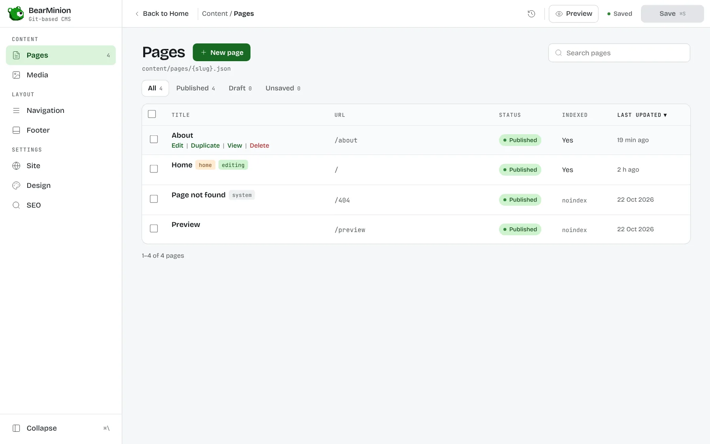

**Pages** lists every page, the home and 404 pages and the site's singles. Every declared multi type has a listing of its own, with its entries and its listing page.

- **New page** (or New entry) asks for a title, a slug and the section the document starts from, then opens it. It starts as a draft unless you turn that off.
- **Search** matches the title and the slug.
- **All, Published, Draft, Unsaved** filter by status, each with a count. Unsaved is the document open on the page while it has unsaved changes.
- Click a column header to sort by it. The default is Last updated, newest first. The time is the file's, so it shows what changed on disk.
- Hover a row for **Edit**, **Duplicate** (a draft copy called “… (copy)” at `<slug>-copy`), **View** (the page in a new tab) and **Delete**. Select rows with their checkboxes to delete several. The home and 404 pages, singles, listing pages and the open document are never deleted, and a type that turns deleting off has no Delete at all. Deleting asks first and removes the file at once, not on the next save.
- Ten rows a page.

A listing page and a single are marked `listing` and `single`: their content is edited like any page, but their address is set in the content model. Unsaved drafts, undo steps and saved versions are kept per document, so the page `contact` and the post `contact` never mix.

#### Media

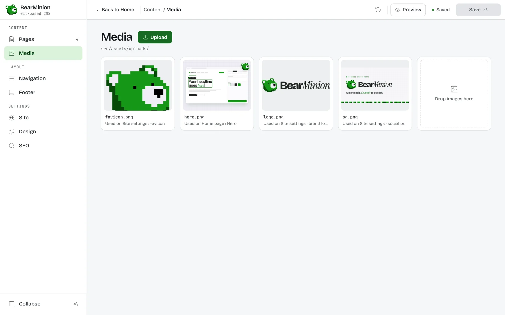

Every uploaded image in `src/assets/uploads`, with where the saved content uses it (“Used on Home page › Hero”) or “Not used”. **Upload**, or drop images on the last tile, adds them; an image nothing uses can be deleted from its card. The same rules as the [image picker](#images) apply.

#### Site status

For the developer: what the site runs and what can be added, with each command next to a Copy button. Nothing is installed from the editor; the commands run in the project folder.

- **The status card**: the installed `bearminion` and whether it is the **Latest release** (the screen asks npm, `registry.npmjs.org/bearminion/latest`; with a newer one it says **Update available** and offers `npm install bearminion@latest`), then the verdict, such as "All 17 sections up to date" or "2 of 15 sections need attention · 2 not installed", with `npx bearminion status`.
- **Installed sections**, compared with the release the way [`bearminion status`](cli.md#see-what-is-out-of-date) does. Healthy sections carry no badge. Those that need attention come first, with a note and a command: **Out of date** (`npx bearminion@latest add <name>`) and **Changed** where you and the release both changed files (`npx bearminion add <name> --diff`). A section you changed that the release did not is marked **Changed** with nothing to do; a section the site defines itself is **Your own**.
- **Not installed**: the release's sections the site does not have, with `npx bearminion add <name>`.
- **More to add**, beside them: the hosted editor (`add hosted --install`), a blog, a content type and a form handler. The editor does not tell whether these are set up already.

In the hosted editor there are no files to compare, so the list shows the installed sections without badges and the card points to `npx bearminion status`.

#### Settings screens

Navigation, Footer, Site, Design and SEO are one screen each, with every group as a card. The file each screen writes is named under its title.

#### Navigation

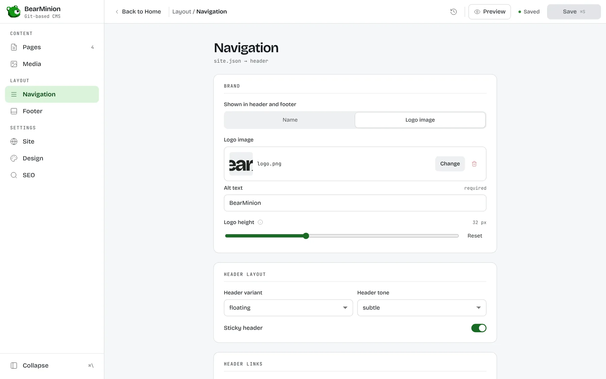

- **Brand.** The name, or a logo image with a height slider.
- **Header layout.** Variant, tone, sticky and, when the theme offers it, **Full-screen mobile menu**: the menu on small screens covers the whole screen instead of dropping down under the header.
- **Links.** Drag a row to reorder or nest it, indent and outdent, and pick a link target. Nesting stops at `MAX_NAV_DEPTH` (3): a top-level link, a child and a grandchild.
- **Buttons.** Up to two header buttons.

##### Links and targets

The same link control edits header links, header buttons, footer links, and button and plan links. It offers:

- existing pages
- `#anchor` on the current page
- `/page#anchor` on other pages
- a custom URL

An internal link to a missing page or anchor shows a warning. It does not block saving.

#### Footer

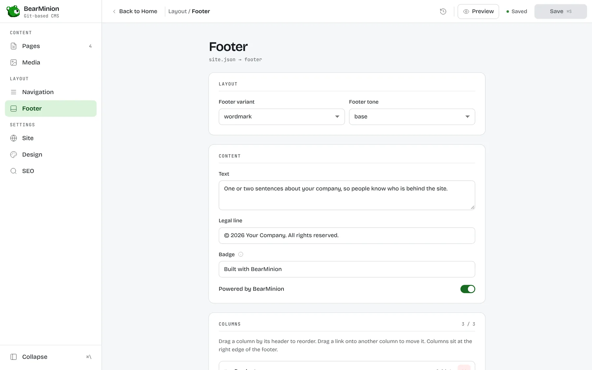

- **Layout.** Variant and tone.
- **Text.** Footer text, the legal line and the badge, and a **Powered by BearMinion** switch. It controls the small link to bearminion.com in the footer's bottom row. Turn it off to remove the link.
- **Columns.** Up to three. Add and remove columns, drag a column by its header to reorder, and drag a link onto another column to move it. Each drag shows what a drop will do.

On the page, the columns stack on small screens, left-aligned: 1 column, then 2 from 416px of footer width, then 3 from 640px. From 896px they sit in a row on the right edge of the footer.

The footer also carries a small “Footer” bar with a settings button that opens this screen.

#### Design

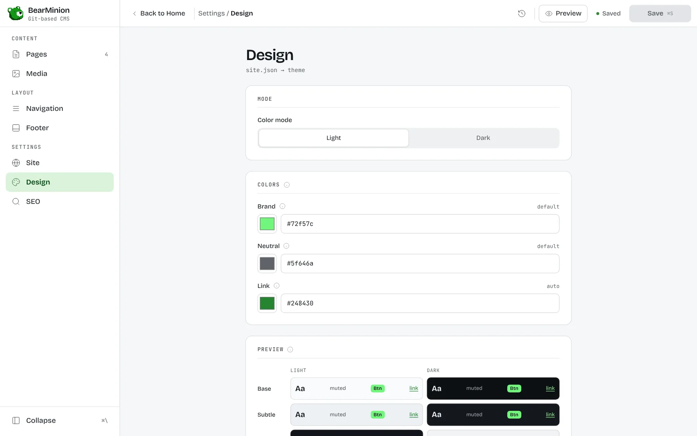

**Seed colors.** Three: brand, neutral and link. Plus the color mode. Tone palettes and dark mode are derived from them (`theme.colors` in `site.json`, `#rrggbb`).

**Contrast.** Text on fills picks near-black or near-white by contrast. Links are moved to 4.5:1. The screen lists any text pair still under WCAG AA. The page previews the palette live.

**In the page.** The layout injects `themeCss(site.theme.colors)` as `<style id="bm-theme">`. A site without colors ships nothing extra.

**Override individual colors.** The Advanced switch replaces any token per mode and tone, via `theme.colors.tones.<light|dark>.<tone>.<token>`. Tokens are background, text, muted text, surface, accent, text on accent and link. The border follows the text color. The same contrast panel checks overrides.

Turning the switch off sets `theme.colors.customTones` to `false`: the overrides stay in the file but are not applied.

The editor's own colors are separate and unaffected.

#### Site

| Group | Fields |
| --- | --- |
| Identity | Name (with style buttons for the selected text and a wordmark preview), URL, favicon |
| Analytics & scripts | Raw snippets for the page head and the end of the body |
| Cookie banner | A switch, a **Count visits without cookies** switch (Google's advanced Consent Mode), and a dialog for the banner's text and privacy policy link |
| Theme | Options from `siteOptions` |

Analytics snippets run on your live site only: not in dev, and not on Vercel or Netlify previews. See [Analytics](getting-started.md#analytics) for how the template decides, and the `BEARMINION_ANALYTICS` override. With the cookie banner on, which is the default, they also wait until the visitor accepts, except the head snippet in advanced mode: see [Cookie banner](getting-started.md#cookie-banner).

#### SEO

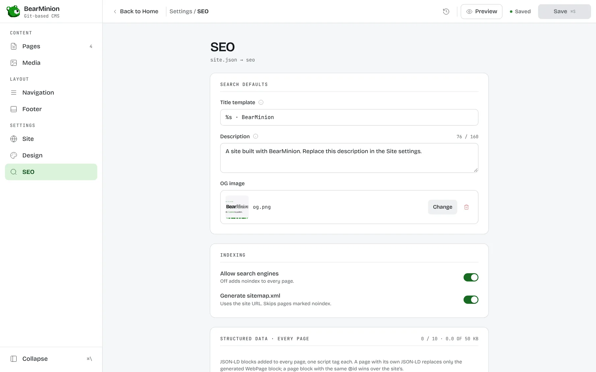

| Group | Fields |
| --- | --- |
| Search defaults | Title template, description, OG image |
| Indexing | **Allow search engines** and **Generate sitemap.xml** |
| Structured data · every page | The JSON-LD every page carries, one card per block |

**Indexing.** Turning off Allow search engines (`seo.robots: false` in `site.json`) adds `noindex` to every page and makes `robots.txt` disallow the site. Turning off Generate sitemap.xml (`seo.sitemap: false`) leaves the sitemap out of the build and the `Sitemap:` line out of `robots.txt`. Both are on by default, and only `false` is stored. The starter's `src/components/seo/Seo.astro`, `src/pages/robots.txt.ts` and `astro.config.ts` read them; a site created before these switches existed has its own copies of those files, so see [Update a site to the Indexing switches](#update-a-site-to-the-indexing-switches).

**Structured data.** One collapsible card per block, named by its `@type` and `@id`, with a `valid`, `warning` (no `@context` or `@type`) or `error` (not valid JSON) badge. A card takes an object, an array, or a pasted `<script type="application/ld+json">` tag, the same as the page SEO dialog, and **Format** tidies it and splits an array into one card per block. A valid edit goes into the draft as you type; while a card is broken the draft keeps its last valid version. The meter counts the blocks (10 at most) and their size (50 KB at most). A page with its own JSON-LD replaces only the generated WebPage block, and a page block with the same `@id` wins over the site's.

**Generate Organization and WebSite** fills both blocks from the site name, address and language (`en` when none is set). It never runs by itself. Blocks that already have the same `@id` are replaced and every other block is kept, so you can run it again after renaming the site. A logo is added only when the brand logo is a full `https://` address, because an uploaded image gets its public address when the site is built. Paste a `"logo"` URL by hand otherwise. While the site address is still `https://example.com`, the screen warns you before you generate. There is no `SearchAction`: Google no longer shows the sitelinks search box, so the markup would have no effect.

##### Update a site to the Indexing switches

A site created before these switches existed keeps working as it was: the switches are stored, but its own files do not read them yet. To have them take effect, make three small changes:

1. In `src/components/seo/Seo.astro`, count `site.seo.robots === false` as `noindex`:

   ```ts
   const noindex = page.seo.noindex || site.seo.robots === false
   const robots = [noindex ? 'noindex' : 'index', page.seo.nofollow ? 'nofollow' : 'follow'].join(', ')
   ```

2. In `astro.config.ts`, leave the sitemap out when it is turned off:

   ```ts
   ...(content.site.seo.sitemap === false ? [] : [sitemap({ filter: createSitemapFilter(routes) })]),
   ```

3. In `src/pages/robots.txt.ts`, read both switches. The starter's file is:

   ```ts
   import type { APIRoute } from 'astro'
   import { getSite } from '../lib/content'

   export const GET: APIRoute = async ({ site: origin }) => {
     const { seo } = await getSite()
     const lines = ['User-agent: *', seo.robots === false ? 'Disallow: /' : 'Allow: /']
     if (seo.sitemap !== false) lines.push(`Sitemap: ${new URL('sitemap-index.xml', origin ?? new URL('https://example.com')).href}`)
     return new Response(`${lines.join('\n')}\n`, { headers: { 'Content-Type': 'text/plain; charset=utf-8' } })
   }
   ```

Page status needs no change in your files: drafts are left out by `siteRoutes`, which the starter's routes and sitemap already use.

### Viewport

Desktop is the page itself, where you edit. **Tablet** (820px) and **Mobile** (390px) show the same address in a frame of that width, with the unsaved draft, so the site's own media queries apply. Nothing in the frame is editable and its links do not navigate; switch back to Desktop to edit. The inspector stays beside the frame, and its edits show in the frame a moment later.

## Images

Every image field is the same control: sections, logo, OG images.

- An empty slot, or a thumbnail with the file name.
- Alt text, marked required (not on OG images).
- A **Caption**, for pictures in a list that allows one, such as a Gallery. It shows under the picture in the lightbox, and an empty caption shows the alt text instead.
- Fit (Cover, Contain, Auto) and Position (a 3×3 grid, disabled for Auto) for images that sit in a frame. Not for logos.
- Change image and Remove.
- **Show in section** for images that sit in a section. Off writes `hidden: true`, which removes the image and its frame from the page while the file and alt text stay.

Click the slot, or Change image, to open the picker. On the page, click an image slot (the image, its frame or an empty placeholder) to open the same picker over the page. The [Media](#media) screen shows the whole library.

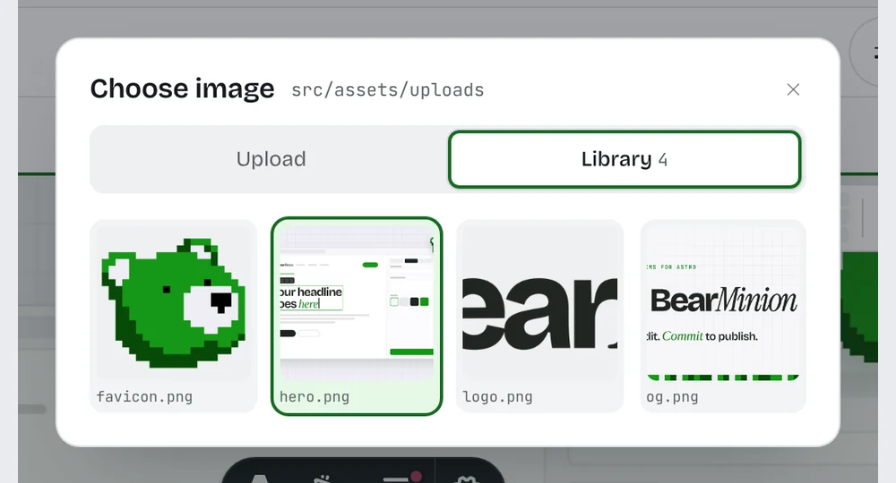

- **Upload.** Drop a file or click to browse. New files go to `src/assets/uploads` and show in the library immediately.
  - **Size limit.** An image over the limit (5 MB by default, `maxImageBytes`) is refused in the browser before anything is uploaded, and the message gives its size and the limit.
  - **Conversion.** With `imageConvert` set in the `bearminion()` options, the editor scales a wide image down to `maxWidth` and saves it as WebP before it uploads, so a 12 MB phone photo arrives as a few hundred KB. Re-encoding also removes the photo's metadata, including the GPS position, and applies its rotation. A GIF is never converted, an image that would come out larger is kept as it is, and a browser that cannot encode WebP uploads the original. See [Integration](integration.md).
- **Library.** Pick an upload, or delete one from disk after a confirm. An image that saved content still uses cannot be deleted, and the error names where it is used.


### Videos

A Media section's **Video** field takes a YouTube or Vimeo link, a link to a video file, or a path in `public/`. Under it the editor says what the link is, or why it will not play (a page link, for example). While the field is empty it reminds you that a YouTube or Vimeo link works as it is. **Upload a video file** saves an `.mp4`, `.webm`, `.mov` or `.ogv` to `public/videos` and fills the field with its address, such as `/videos/demo-1a2b3c4d.mp4`. **Uploaded videos** lists the ones already there. The default limit is 50 MB (`maxVideoBytes`), and above 10 MB the editor warns that the file will be slow to load. Video bytes are checked against the file type, not the name. A video a saved page still links cannot be deleted from the API (`409`).

Hovering a section image at least 260 × 64 px shows a bar with Fit, Position and Change.

An image whose file is gone shows a Missing image placeholder on the page and File not found in its field. Saving fails until you choose another image.

In dev, a `src/assets/` path that is not in the eager `import.meta.glob` is rendered as a plain image whose URL is `/__bearminion/assets?src=...`. That route only serves a file inside `src/assets` or the uploads directory, and only to localhost. Production builds do not include the route. They still resolve the path with the glob and Astro `<Image>`, and they still fail the build when the file is missing.

## Preview

**Preview** in the top bar hides the navigation, the inspector and every outline and bar, so the page looks as visitors see it across the whole width. The top bar stays with one button, **Exit preview**; Esc does the same. Preview mode survives a reload until you leave it.

## Save, drafts and history

### Drafts

Edits stay in an in-memory draft.

- Text you type on the page changes the DOM immediately.
- Tone, motion and spacing update the `data-*` attributes on the section, so the existing CSS repaints it.
- A variant change, a section you add, duplicate, move or delete, any value you type in the inspector, and a value with no text of its own on the page (a video link, a section option, an optional field filled or emptied) go to `POST /__bearminion/api/preview`. The page shows an inspector edit about a fifth of a second after you stop typing.

The dev server validates that JSON, renders the page sections with Astro's container API through the Vite SSR module runner (the theme's `defineThemePreview` module, `/src/lib/render-preview.ts` by default), and returns HTML. The overlay replaces `main#content`, runs any script in the new markup that the page has not loaded yet, and dispatches `bearminion:preview` so scripts already on the page can bind the new nodes. The response is not written to disk.

Header, navigation, footer and other `site.json` fields appear after you save and reload. The first time one of those changes, the editor asks you to save and reload now or keep editing. The notice stays while the site draft is dirty.

### Save

Save in the top bar, or Ctrl or Cmd+S, is the only way to write the draft to disk. It sends the page and the site in one `POST /save`.

- The server validates both, including a rename, before it writes anything. Then it writes them together. The page reloads only after that succeeds, and comes back at the same scroll position, view and inspector.
- A validation error stays on the page. The inspector and the open full-screen view list the field errors, repeated next to the matching control.
- Closing or reloading the tab with unsaved edits triggers the browser's beforeunload warning.
- Save does not create a git commit. Use **Commit changes** in the top bar ([git](#git)).

**Unsaved · N changes** in the top bar opens the list of what differs from the files, field by field, with Save and **Discard**. Discard asks first, then reloads the page and the site from disk.

A content-file change, a Vite full reload, a link to another page, or a document opened from a listing goes through the same choice when the draft is dirty: save and reload, discard changes, or cancel.

### Autosaved drafts

While a draft differs from the last saved JSON, the editor stores it in `localStorage` after about 500ms.

- Keys are `bearminion:draft:<projectId>:page:<slug>` and `bearminion:draft:<projectId>:site`.
- `projectId` is a hash of the dev server root and the site name, so two projects on the same localhost port do not share drafts.
- Each record stores the draft, a timestamp and a hash of the on-disk JSON it was based on.
- Drafts older than 14 days are removed.
- If storage is disabled or full, the editor keeps editing and skips the autosave.

When you open a page with a stored draft, a banner says “Unsaved changes from <relative time>” and offers Restore or Discard. If the file changed after the draft was based on it, the banner also says so. Restore and Discard still work. A successful save or Discard clears the stored draft.

Another tab that saves the same page raises “Another tab saved this page.”

### History

History in the top bar has two tabs.

**This session** is the undo history of the open document: every settled edit is a step, and a burst of typing is one. Pick a step to go back to it, or forward again; it is the same as pressing Undo or Redo that many times.

- The steps are kept in the tab's `sessionStorage` (`bearminion:undo:<projectId>:<document>`), one stack per document. They survive a reload, a save and a visit to another page, and are gone when the tab closes. Another tab has its own.
- Coming back to a document records it as it is now, so the first Undo returns to where you left it.
- Each document keeps up to 100 steps and about 1 MB; the oldest go first, and the least recently used documents go when the tab's storage is full. With storage blocked, undo still works until the next reload.

**Commits** lists the repository's commits that changed the content, the uploads, the videos or a [collection](collections.md); commits of code only are left out, and so are the code files of a commit that changed both. **Open full history**, or **History** in the navigation, opens the History screen:

- The commits, newest first, with their message, short hash, author and time. In a hosted editor with `mode: 'pr'`, the saves on open `bearminion/*` pull requests come first, marked **not published**.
- The commit you pick, file by file: for a page or `site.json` the fields it changed, the way **Unsaved changes** shows them; for other text files the changed lines; for images, before and after.
- **Restore this version** (or **Restore file** on one file) puts the files back as they were in that commit, with the images they point at that were deleted since, as **one new commit** on top. Nothing in the history is rewritten. In a hosted editor with `mode: 'pr'` the commit goes to the page's pull request (or a shared `edits` one), so it is published when that is merged.
- Locally, a restore refuses to overwrite files with uncommitted changes. With `git` off it writes the files and leaves the commit to you.
- When a restore touches the open document or `site.json`, the editor reloads them; unsaved edits to them are discarded, and the confirmation says so.

A project that is not in a git repository has no Commits tab content: it says so.

### Git

`bearminion({ git: true })` enables `GET /git` and `POST /git/commit` (`{ message, paths? }`).

- Only changed files under `contentDir` and `uploadsDir` can be committed.
- Git runs without a shell, and there is no push.
- With `git` off, or outside a repo, the editor hides Commit changes.
- [History](#history) reads the commits whenever the project is in a git repository, whatever `git` is set to.

## Keyboard shortcuts

| Keys | Does |
| --- | --- |
| Ctrl/Cmd+S | Saves the page and the site |
| Ctrl/Cmd+Z, Shift+Ctrl/Cmd+Z | Undo and redo, outside a text field |
| Ctrl/Cmd+E | Shows or hides the inspector |
| Ctrl/Cmd+\\ | Collapses or expands the navigation |
| Esc | Blurs the field you are editing. Then closes, in order: a dialog or popover, a confirmation, the link popover, the format bar, the add-section picker; leaves preview; and goes back from a full-screen view to the page |
| Left, Right | Moves between the inspector tabs when focus is on the tab list |
| Arrow keys, Home, End on the inspector's edge | Change the inspector width |
