The editor is a dev-only overlay on your own site. You edit the page where it is, and the sidebar holds everything that is not on the page. Nothing reaches your files until you save.

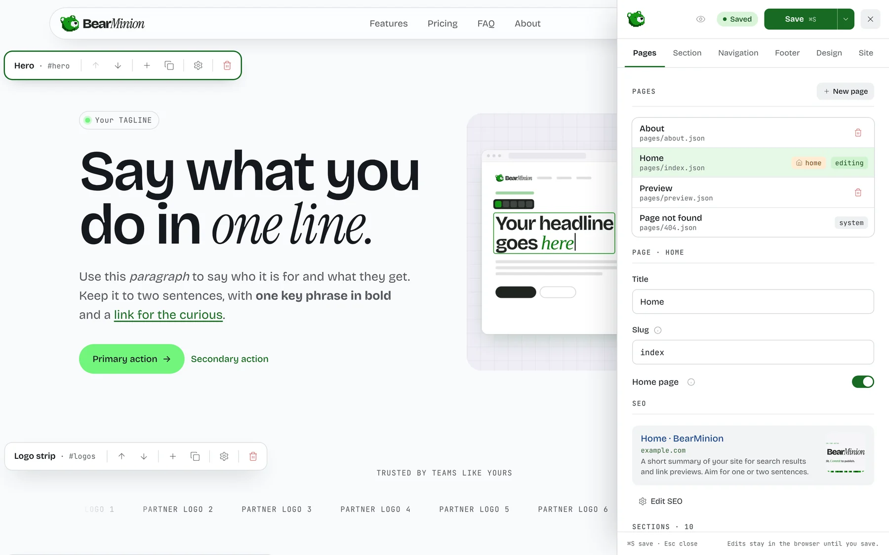

On this page:

- [Open the editor](#open-the-editor)
- [Edit text on the page](#edit-text-on-the-page)
- [Edit sections](#edit-sections)
- [The sidebar](#the-sidebar): [Pages](#pages), [Section](#section), [Navigation](#navigation), [Footer](#footer), [Design](#design) and [Site](#site)
- [Images](#images)
- [Preview](#preview)
- [Save, drafts and history](#save-drafts-and-history)
- [Keyboard shortcuts](#keyboard-shortcuts)

## Open the editor

Run `npm run dev` in your site (`pnpm dev` from the root of the BearMinion repository). A dock at the top right opens the sidebar. The shortcut is Ctrl+E or Cmd+E.

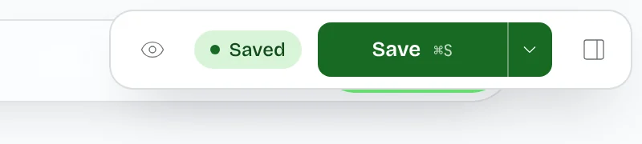

The dock has four controls:

- **Preview** hides all editor chrome ([details](#preview)).
- **Saved or Unsaved** shows whether the draft differs from what is on disk.
- **Save** writes the page and the site.
- **Panel** opens the sidebar.

## Edit text on the page

Click any text marked `data-field` and type. Enter commits a single-line field. Pasting into a plain field pastes plain text.

### Headings and the site name

Select words in a heading or in the site name to open the format bar. It sets weight (400, 500, 600, 700) and font (sans, serif, mono) for the selection.

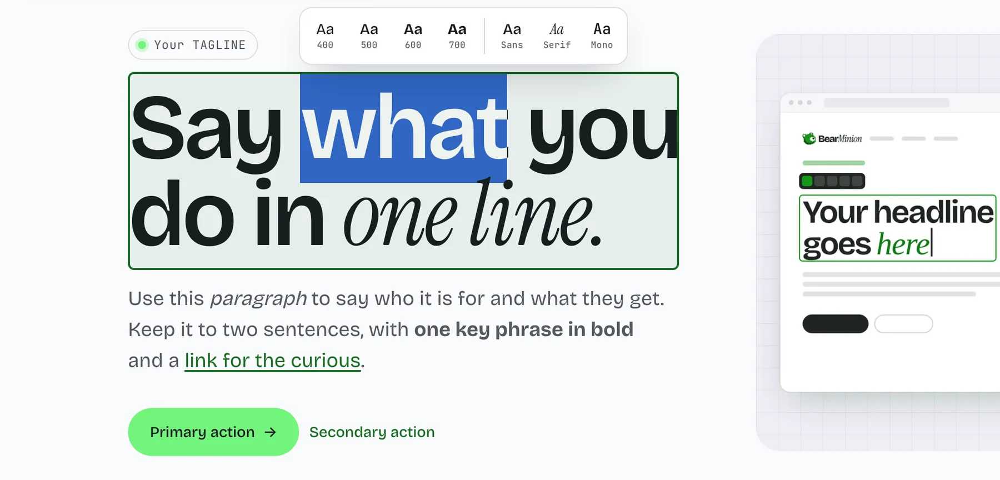

Replacing a heading keeps inline marks aligned with the new text. A mark is dropped when its word is gone.

### Formatted text

Fields whose path ends in `body`, `intro`, `sub`, `description`, `quote`, `note`, `thanks` or `a`, list items under `points`, and any field with `data-field-kind="rich"` are edited as formatted text.

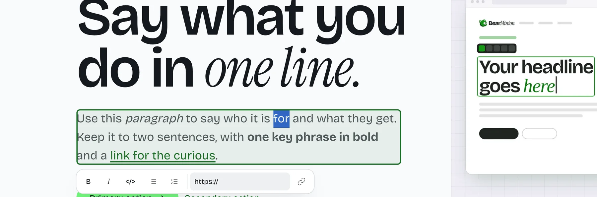

| Control | Result |
| --- | --- |
| Bold, italic, code | `**bold**`, `*italic*`, `` `code` `` |
| Link | `[text](url)`. Add `{new}` or `{same}` so the new-window choice round-trips |
| Bulleted or numbered list | `- item`, `1. item` |
| Enter | In a list, starts the next item. On an empty item, leaves the list. Elsewhere, a line break |

The stored value is Markdown, with blank lines for paragraphs. Text in backticks is literal: nothing inside it is parsed.

Headings are fields, and images are [image slots](#images). Rich-text fields have no heading buttons, with one exception: a field the theme marks with `data-rich-headings="true"` (the starter's Text section) adds **H2** and **H3** buttons to the toolbar. They write `## heading` and `### heading` on their own line. Enter at the end of a heading starts a paragraph, and Shift+Enter does nothing in one. Pasted `h1` to `h6` become H2 or H3 there, and are dropped everywhere else.

#### What the starter renders

The starter renders that Markdown as `strong`, `em`, `code`, `a`, `br`, `p`, `ul` and `ol`, and escapes every other character.

- `javascript:`, `data:` and `vbscript:` URLs are dropped.
- `http` and `https` links get `target="_blank"` and `rel="noopener noreferrer"`, unless `{same}` is set.
- Pasted HTML is parsed with `DOMParser`, read back as that Markdown subset and rendered again. Images, attributes and event handlers from the clipboard are dropped, and so are headings in a field that has none.

### Links and buttons

Click a link or button on the page to open a popover for the label, the URL and “Open in new window”. Buttons and call-to-action links also take an optional HTML id. Optional buttons have a Remove action.

## Edit sections

Hover or select a section to outline it and show a toolbar on its top edge.

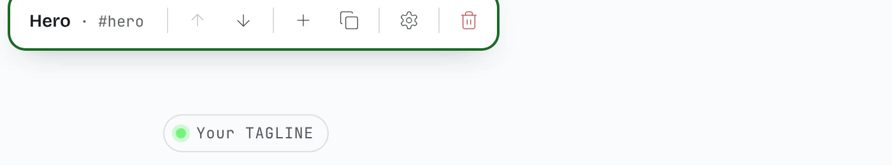

| Control | What it does |
| --- | --- |
| Name | The catalog label plus the anchor, such as `Pricing · #pricing`. Truncated, with the full text in a tooltip |
| Move up, move down | Disabled at the ends |
| Add | Opens “Add above” and “Add below”, then the section-type list |
| Duplicate | Asks for confirmation, then changes the draft |
| Settings | Opens the [Section tab](#section) for this section |
| Delete | Danger style. Asks for confirmation, then changes the draft |

The toolbar stays visible while the section is in view. When the section top scrolls past, it pins under a sticky site header until the section ends, also while the sidebar is open. It does not cover the next section's toolbar. Escape cancels a confirmation and Enter confirms it.

## The sidebar

The tabs are Pages, Section, Navigation, Footer, Design and Site. The sidebar opens on Pages, and after a reload it comes back open on the tab you were on.

The header shows the BearMinion mark, the preview button, the Saved or Unsaved pill, Save (same as Ctrl/Cmd+S) with a [menu](#save-menu), and a close button.

The panel starts at 440px. A handle on its left edge drags the width, arrow keys step it and a double-click resets it. The width stays between 380px and 40% of the viewport (the minimum shrinks when 40% is smaller than 380px) and is stored in `localStorage` as `bearminion:sidebar-width`. While the sidebar is open, the page gets that much right padding, so the section you edit stays beside the panel.

### Pages

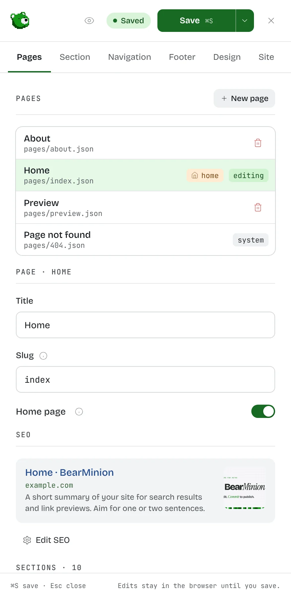

**The page list.** Follow a link to open a page, delete one, or create one from a section template with New page.

**The current page.** Title, slug (a rename is applied on save) and the Home page switch.

- The home page is `index`, shows a home badge in the list, and its slug is locked.
- Turning the switch on for another page asks before it replaces the current home, which moves to a slug generated from its title.

**Outline.** A numbered list of the page's sections. Clicking a row opens that section on the Section tab.

#### SEO

The SEO card shows the page as a search result, with the social image as a square thumbnail and badges for what is set (noindex, nofollow, canonical, JSON-LD). Problems with `seo.*` fields are listed on the card.

**Edit SEO** opens a dialog.

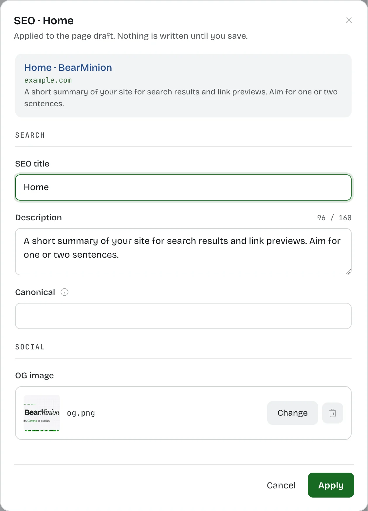

| Field | Notes |
| --- | --- |
| SEO title | Falls back to the page title and the site's title template |
| Description | With a character count |
| Canonical | Optional |
| OG image | The same [image field](#images) as everywhere else |
| noindex, nofollow | Switches |
| JSON-LD | An object, an array, or a pasted `<script type="application/ld+json">` tag. A Format button tidies it. A missing `@context` or `@type` is a warning |

Apply is blocked while the JSON is invalid. The dialog edits a copy: Apply writes one undo step, Cancel or Escape drops the edits. The page scroll is locked behind the dialog without shifting the layout.

### Section

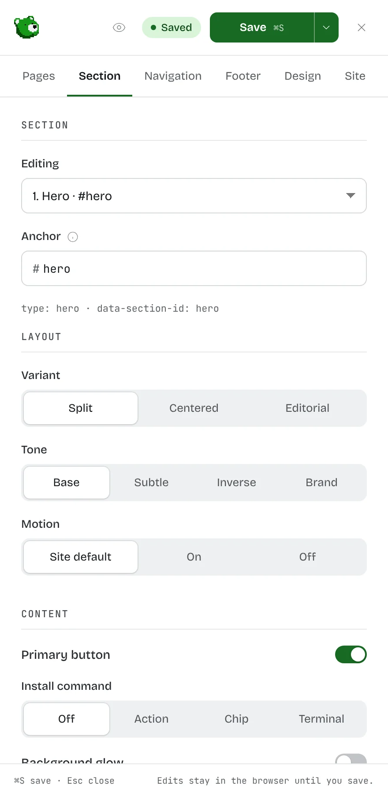

The tab has three groups, top to bottom:

1. **Section.** The section picker and the anchor.
2. **Layout.** Variant, tone, and motion (Site default, On or Off).
3. **Content.** The other options and every prop.

Choices with up to four values are segmented controls, longer lists are selects, and a field with icons (a step's icon) is an icon grid. Props the current options do not use are hidden, such as the poster while a Media section shows an image. Their values stay in the file.

**Anchor.** A lowercase slug, unique on the page. It is suggested from the heading (or the section type) when empty. The section element uses it as `id`. `data-section-id` stays the section id.

**Lists.** Collapsible rows. Drag a row by its grip, or use the up and down buttons: a row you move keeps its place on screen, stays open, and keeps focus on the button, so you can press it again. Each drag shows where the row will land. Remove deletes a row.

**Optional text and buttons.** Clear an optional text field and it is hidden on the page and dropped from the file on save. A button has a Remove control and, once gone, an Add slot. A wrapper whose children are all gone (a section header, an actions row) is not rendered. What defines an item, such as a feature title or a question and its answer, stays required: remove the whole item instead. `section-optional.ts` lists the optional props.

**Links.** Link fields open the same [link control](#links-and-targets) as the Navigation tab.

**Form handler.** A Contact section has no endpoint or key fields. Its settings end with a note about the code behind the form: a warning while `src/forms/contact.ts` does not exist, and once it does, a line saying the form posts to `/api/contact`, is handled by your own code, and has to be tested by hand because BearMinion cannot check it. The note reads the folder each time the section opens, so a new file shows up without a restart. See [Forms](forms/README.md).

Duplicate section and Delete section sit at the bottom and ask for confirmation.

### Navigation

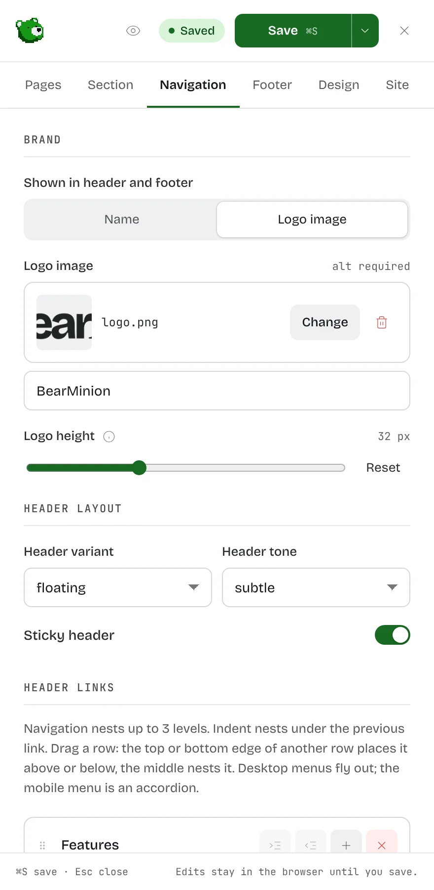

- **Brand.** The name, or a logo image with a height slider.
- **Header layout.** Variant, tone and sticky.
- **Links.** Drag a row to reorder or nest it, indent and outdent, and pick a link target. Nesting stops at `MAX_NAV_DEPTH` (3): a top-level link, a child and a grandchild.
- **Buttons.** Up to two header buttons.

#### Links and targets

The same link control edits header links, header buttons, footer links, and button and plan links. It offers:

- existing pages
- `#anchor` on the current page
- `/page#anchor` on other pages
- a custom URL

An internal link to a missing page or anchor shows a warning. It does not block saving.

### Footer

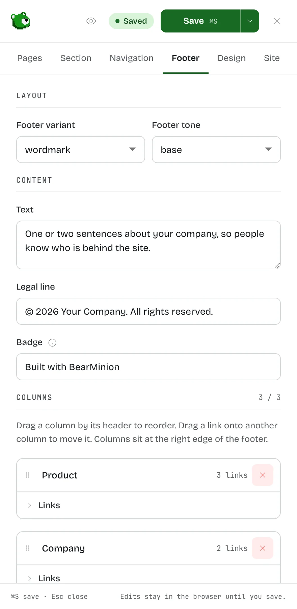

- **Layout.** Variant and tone.
- **Text.** Footer text, the legal line and the badge.
- **Columns.** Up to three. Add and remove columns, drag a column by its header to reorder, and drag a link onto another column to move it. Each drag shows what a drop will do.

On the page, the columns stack on small screens, left-aligned: 1 column, then 2 from 416px of footer width, then 3 from 640px. From 896px they sit in a row on the right edge of the footer.

The footer also carries a small “Footer” bar with a settings button that opens this tab.

### Design

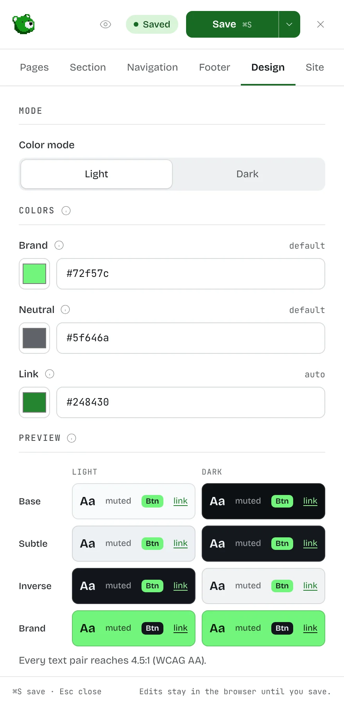

**Seed colors.** Three: brand, neutral and link. Plus the color mode. Tone palettes and dark mode are derived from them (`theme.colors` in `site.json`, `#rrggbb`).

**Contrast.** Text on fills picks near-black or near-white by contrast. Links are moved to 4.5:1. The tab lists any text pair still under WCAG AA. The page previews the palette live.

**In the page.** The layout injects `themeCss(site.theme.colors)` as `<style id="bm-theme">`. A site without colors ships nothing extra.

**Override individual colors.** The Advanced switch replaces any token per mode and tone, via `theme.colors.tones.<light|dark>.<tone>.<token>`. Tokens are background, text, muted text, surface, accent, text on accent and link. The border follows the text color. The same contrast panel checks overrides.

Turning the switch off sets `theme.colors.customTones` to `false`: the overrides stay in the file but are not applied.

The editor's own colors are separate and unaffected.

### Site

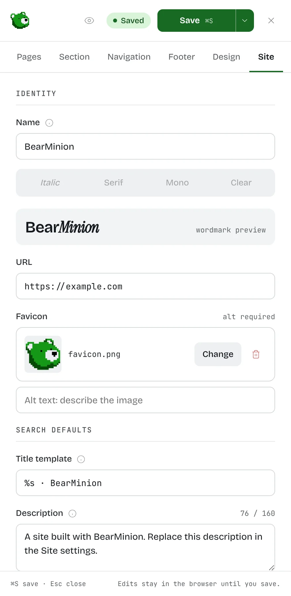

| Group | Fields |
| --- | --- |
| Identity | Name (with style buttons for the selected text and a wordmark preview), URL, favicon |
| Search defaults | Title template, description, og image |
| Analytics & scripts | Raw snippets for the page head and the end of the body |
| Structured data | The JSON-LD every page carries, edited in a dialog. See [Site JSON-LD](#site-json-ld) |
| Cookie banner | A switch, and a dialog for the banner's text and privacy policy link |
| Theme | Options from `siteOptions` |

Analytics snippets run on your live site only: not in dev, and not on Vercel or Netlify previews. See [Analytics](getting-started.md#analytics) for how the template decides, and the `BEARMINION_ANALYTICS` override. With the cookie banner on, which is the default, they also wait until the visitor accepts: see [Cookie banner](getting-started.md#cookie-banner).

#### Site JSON-LD

**Edit JSON-LD** in the Structured data group opens a dialog with the blocks every page carries. It takes an object, an array, or a pasted `<script type="application/ld+json">` tag, the same as the page SEO dialog, and Apply is blocked while the JSON is invalid.

**Generate Organization and WebSite** fills both blocks from the site name, address and language (`en` when none is set). It never runs by itself. Blocks that already have the same `@id` are replaced and every other block is kept, so you can run it again after renaming the site. A logo is added only when the brand logo is a full `https://` address, because an uploaded image gets its public address when the site is built. Paste a `"logo"` URL by hand otherwise.

While the site address is still `https://example.com`, the dialog warns you before you generate. There is no `SearchAction`: Google no longer shows the sitelinks search box, so the markup would have no effect.

## Images

Every image field is the same control: sections, logo, OG images.

- An empty slot, or a thumbnail with the file name.
- Alt text, marked required (not on OG images).
- A **Caption**, for pictures in a list that allows one, such as a Gallery. It shows under the picture in the lightbox, and an empty caption shows the alt text instead.
- Fit (Cover, Contain, Auto) and Position (a 3×3 grid, disabled for Auto) for images that sit in a frame. Not for logos.
- Change image and Remove.
- **Show in section** for images that sit in a section. Off writes `hidden: true`, which removes the image and its frame from the page while the file and alt text stay.

Click the slot, or Change image, to open the picker. On the page, click an image slot (the image, its frame or an empty placeholder) to open the same picker over the page, without the sidebar.

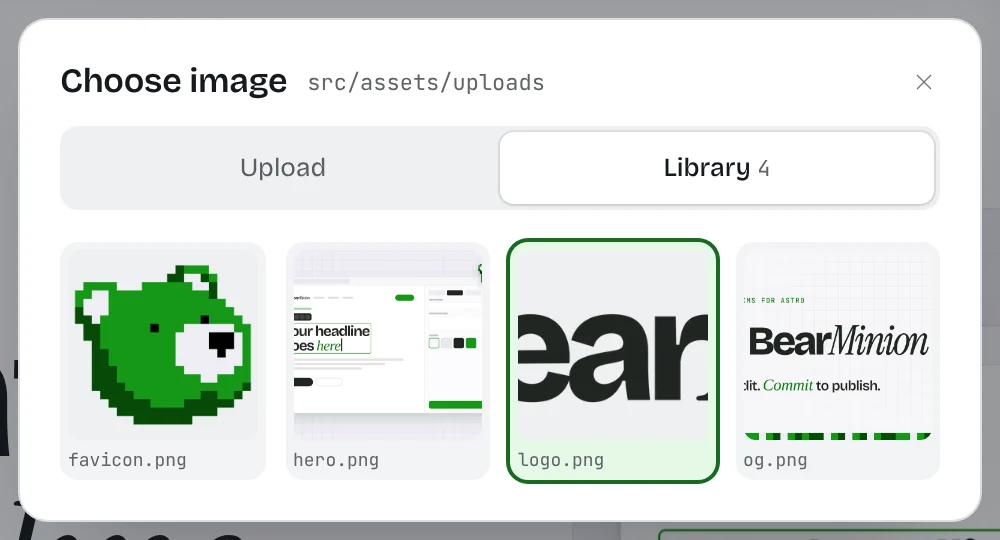

- **Upload.** Drop a file or click to browse. New files go to `src/assets/uploads` and show in the library immediately.
- **Library.** Pick an upload, or delete one from disk after a confirm. An image that saved content still uses cannot be deleted, and the error names where it is used.

### Videos

A Media section's **Video** field takes a YouTube or Vimeo link, a link to a video file, or a path in `public/`. Under it the editor says what the link is, or why it will not play (a page link, for example). While the field is empty it reminds you that a YouTube or Vimeo link works as it is. **Upload a video file** saves an `.mp4`, `.webm`, `.mov` or `.ogv` to `public/videos` and fills the field with its address, such as `/videos/demo-1a2b3c4d.mp4`. **Uploaded videos** lists the ones already there. The default limit is 50 MB (`maxVideoBytes`), and above 10 MB the editor warns that the file will be slow to load. Video bytes are checked against the file type, not the name. A video a saved page still links cannot be deleted from the API (`409`).

Hovering a section image at least 260 × 64 px shows a bar with Fit, Position and Change.

An image whose file is gone shows a Missing image placeholder on the page and File not found in its field. Saving fails until you choose another image.

In dev, a `src/assets/` path that is not in the eager `import.meta.glob` is rendered as a plain image whose URL is `/__bearminion/assets?src=...`. That route only serves a file inside `src/assets` or the uploads directory, and only to localhost. Production builds do not include the route. They still resolve the path with the glob and Astro `<Image>`, and they still fail the build when the file is missing.

## Preview

The eye button in the header, or on the closed editor's bar, hides every panel, outline and bar so the page looks as visitors see it. A bubble at the bottom right, or Esc, exits and reopens the sidebar if it was open.

## Save, drafts and history

### Drafts

Edits stay in an in-memory draft.

- Text you type on the page changes the DOM immediately.
- Tone and motion update the `data-*` attributes on the section, so tone colors follow the existing CSS.
- A variant change, a section you add, duplicate, move or delete, any value you type in the sidebar, and a value with no text of its own on the page (a video link, a section option, an optional field filled or emptied) go to `POST /__bearminion/api/preview`. The page shows a sidebar edit about a fifth of a second after you stop typing.

The dev server validates that JSON, renders the page sections with Astro's container API through the Vite SSR module runner (the theme's `defineThemePreview` module, `/src/lib/render-preview.ts` by default), and returns HTML. The overlay replaces `main#content`, runs any script in the new markup that the page has not loaded yet, and dispatches `bearminion:preview` so scripts already on the page can bind the new nodes. The response is not written to disk.

Header, navigation, footer and other `site.json` fields appear after you save and reload. The first time one of those changes, the editor asks you to save and reload now or keep editing. The sidebar keeps that notice while the site draft is dirty.

### Save

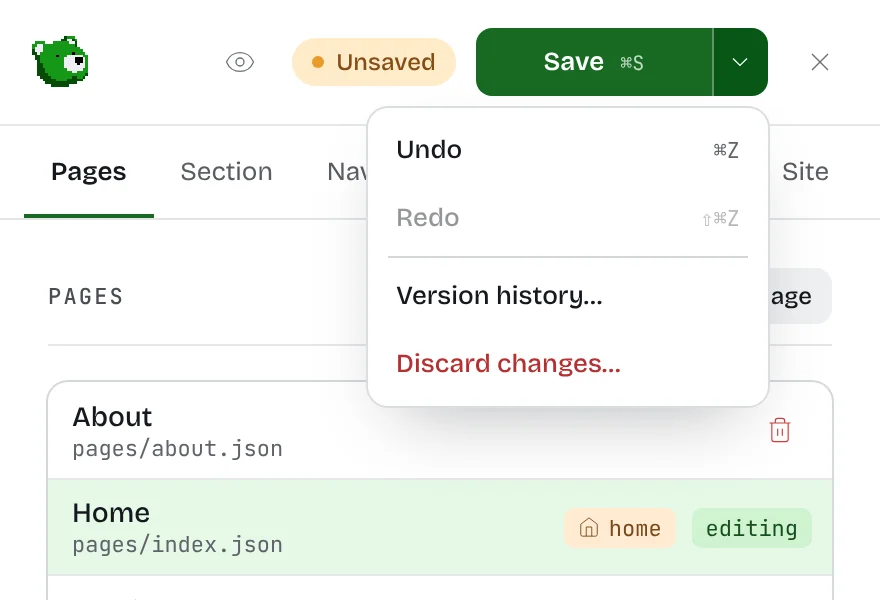

Ctrl or Cmd+S is the only way to write the draft to disk. It sends the page and the site in one `POST /save`.

- The server validates both, including a rename or a move to home, before it writes anything. Then it writes them together. The page reloads only after that succeeds.
- A validation error stays on the page. The sidebar lists the field errors, repeated next to the matching control.
- Closing or reloading the tab with unsaved edits triggers the browser's beforeunload warning.
- Save does not create a git commit. Use Save menu → Commit changes… ([git](#git)).

A content-file change, a Vite full reload, a link to another page, or a page opened from the Pages tab goes through the same choice when the draft is dirty: save and reload, discard changes, or cancel.

#### Save menu

The menu next to Save has Undo, Redo, Version history… and Discard changes…, plus Commit changes… when [git](#git) is on.

### Autosaved drafts

While a draft differs from the last saved JSON, the editor stores it in `localStorage` after about 500ms.

- Keys are `bearminion:draft:<projectId>:page:<slug>` and `bearminion:draft:<projectId>:site`.
- `projectId` is a hash of the dev server root and the site name, so two projects on the same localhost port do not share drafts.
- Each record stores the draft, a timestamp and a hash of the on-disk JSON it was based on.
- Drafts older than 14 days are removed.
- If storage is disabled or full, the editor keeps editing and skips the autosave.

When you open a page with a stored draft, a banner says “Unsaved changes from <relative time>” and offers Restore or Discard. If the file changed after the draft was based on it, the banner also says so. Restore and Discard still work. A successful save or Discard clears the stored draft.

Another tab that saves the same page raises “Another tab saved this page.”

### History

`.editor/history/` keeps the newest 50 saved versions per page and for the site. Add it to `.gitignore`. To clear it, stop the dev server and delete the `.editor` folder.

### Git

`bearminion({ git: true })` enables `GET /git` and `POST /git/commit` (`{ message, paths? }`).

- Only changed files under `contentDir` and `uploadsDir` can be committed.
- Git runs without a shell, and there is no push.
- With `git` off, or outside a repo, the editor hides Commit changes….

## Keyboard shortcuts

| Keys | Does |
| --- | --- |
| Ctrl/Cmd+E | Opens or closes the sidebar |
| Ctrl/Cmd+S | Saves the page and the site |
| Esc | Blurs the field you are editing. Then closes, in order: a confirmation, the link popover, the format bar, the add-section picker, the sidebar |
| Left, Right | Moves between the sidebar tabs when focus is on the tab list |
| Arrow keys on the resize handle | Change the sidebar width |
