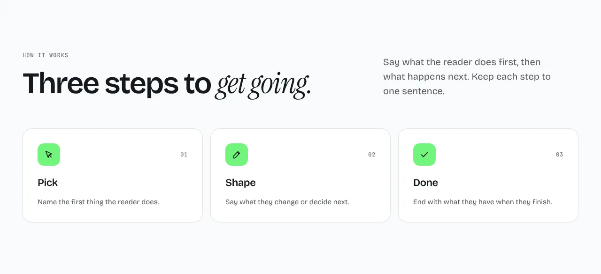
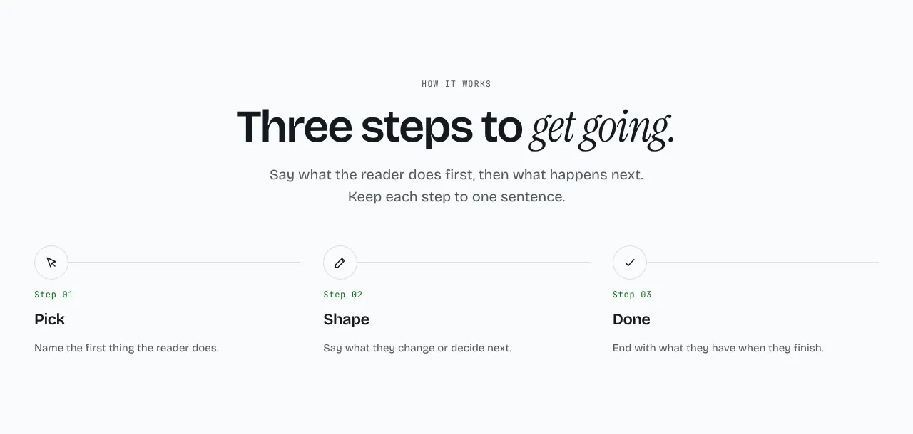
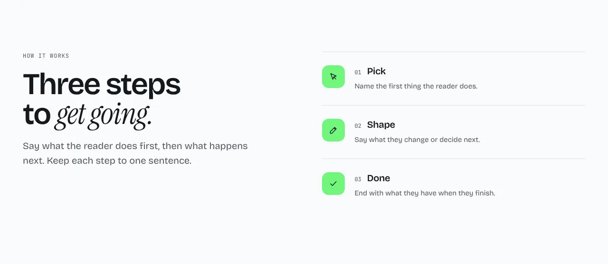
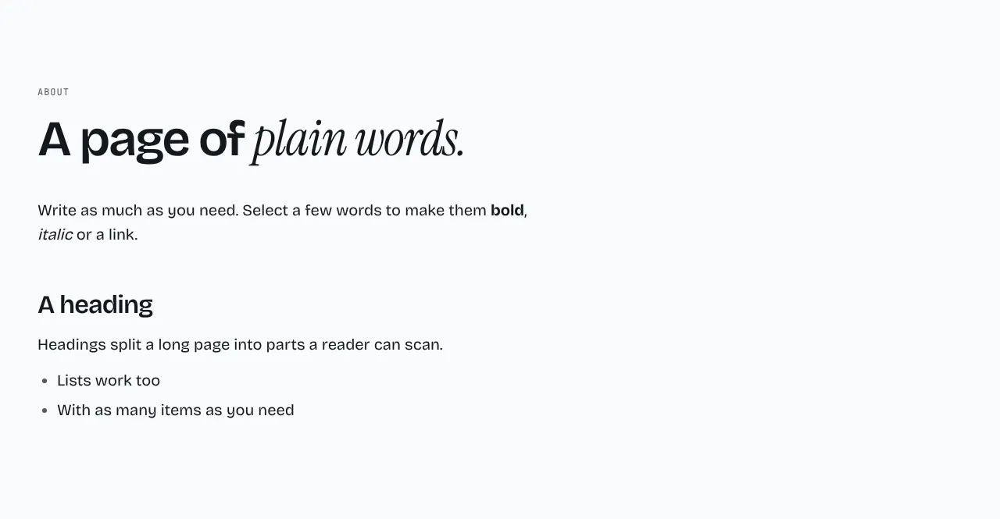
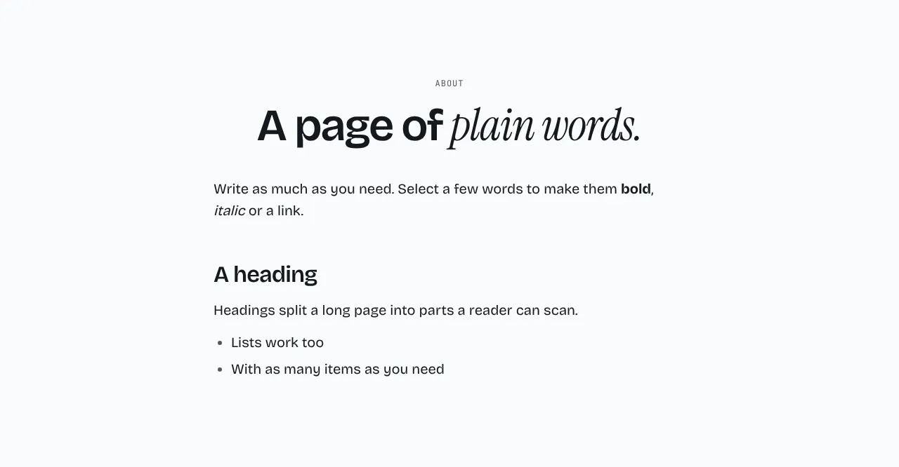
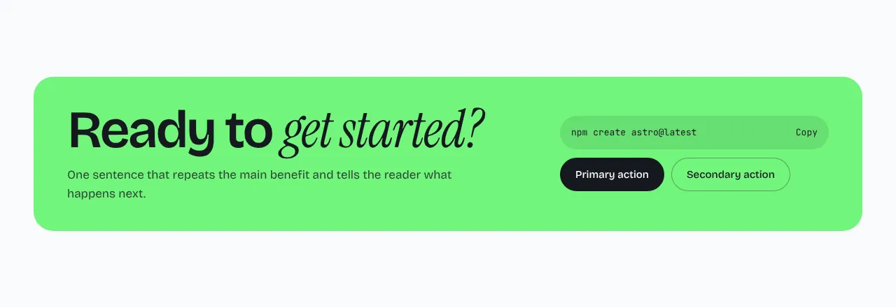
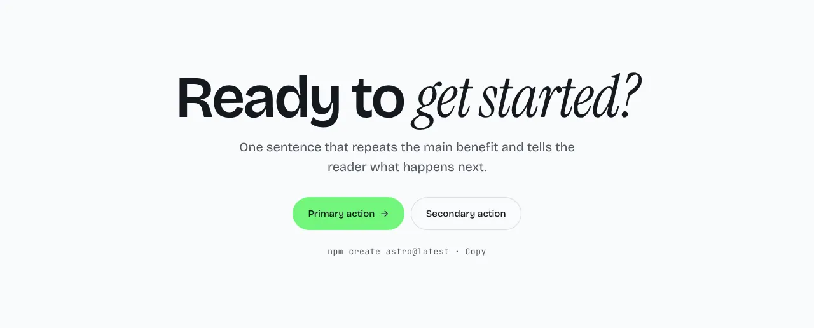
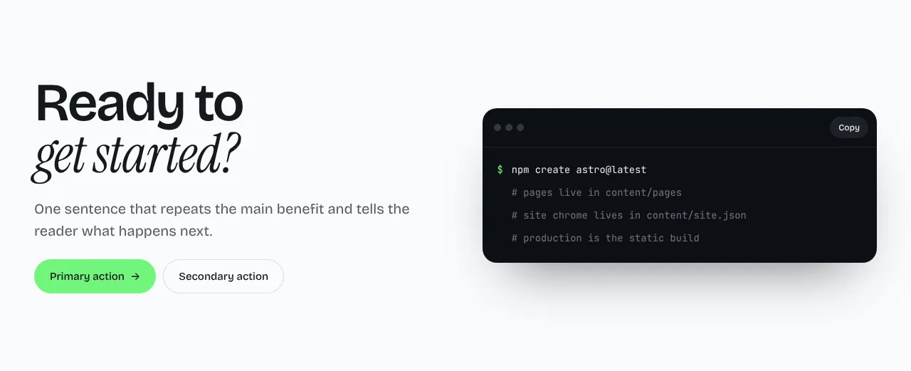

The default template ships 14 section types and 41 layouts. This page lists each one: what it is for, the layouts you can switch between, and the options and content it takes. Every screenshot is the layout with its default content, on the `base` tone.

Every section shares four controls, in the editor's **Section** tab and in the page JSON:

- **Layout** (`variant`): one of the layouts listed under the section.
- **Tone** (`tone`): `base`, `subtle`, `inverse` or `brand`. Every layout works in all four.
- **Motion** (`motion`): whether the section animates in. The site-wide default applies until you set it.
- **Anchor** (`anchor`): an optional lowercase slug that becomes the section's `id`, so a link can jump to it.

Optional text, links and images can be left out. The editor shows an empty field or an **Add** slot, and a built page leaves out whatever is empty. A section with a list shows its recommended length next to the list, and refuses to go outside the minimum and maximum. Sections are defined in `templates/default/src/components/sections/<name>/`. See [Building a theme](themes.md#section-registry) to change one or add your own, and [Content files](content.md) for the JSON.

| Section | Use it for | Layouts |
| --- | --- | --- |
| [Hero](#hero) | The opening of a page | `split`, `centered`, `editorial` |
| [Logo strip](#logo-strip) | Customer or partner logos | `row`, `grid`, `marquee` |
| [Steps](#steps) | A few short points with an icon each | `columns`, `rail`, `list` |
| [Gallery](#gallery) | Many pictures, with a lightbox | `grid`, `masonry`, `featured` |
| [Features](#features) | Cards of benefits | `cards`, `list`, `bento` |
| [Text](#text) | Plain long-form text | `left`, `center` |
| [Text + Image](#text--image) | Text beside a picture | `right`, `left`, `wide` |
| [Stats](#stats) | Big numbers with short labels | `row`, `cards`, `split` |
| [Testimonials](#testimonials) | Quotes with a name | `grid`, `featured`, `carousel` |
| [Pricing](#pricing) | Plans side by side | `tiers`, `table`, `single` |
| [Media](#media) | One video or image | `centered`, `wide`, `split` |
| [FAQ](#faq) | Questions that open to show answers | `accordion`, `split`, `grid` |
| [Call to action](#call-to-action) | A closing heading and button | `band`, `centered`, `terminal` |
| [Contact](#contact) | Contact details beside a form | `split`, `card`, `minimal` |

## Hero

The opening heading, a short intro, up to two buttons and a picture. Put it first on a page.

**`split`** (default): text on the left, the picture on the right.

**`centered`**: everything centered, with a wide picture under the buttons.

**`editorial`**: an oversized heading, then the intro and the buttons side by side under a rule, with the picture below.

Options:

- **Primary button** (`button`, on by default): turn it off to hide the primary button.
- **Install command** (`code`): `off`, `action` (a copy button in the button row, in place of the secondary button), `chip` or `terminal`. It shows the `command` text.
- **Background glow** (`glow`, off by default).

Content, all optional: `eyebrow`, `heading`, `sub`, `badge` (`tag`, `text`, `href`; it takes the eyebrow's place in `split` and `centered`), `primary`, `secondary`, `command` and `image`.

## Logo strip

A row of customer or partner logos under a small label. Each logo needs alt text.

**`row`** (default): the logos in one row beside the label, wrapping on narrow screens.

**`grid`**: the logos in a ruled grid.

**`marquee`**: the logos scroll sideways in a loop, and pause while the pointer is over them or focus is inside.

Content: `label` (optional) and `logos`, six recommended.

## Steps

A few short points, each with an icon, a title and a description. Use it for steps or for reasons.

**`columns`** (default): the steps as cards side by side.

**`rail`**: a centered heading, with the steps along a thin line.

**`list`**: the heading on the left, the steps as a numbered list on the right.

Options: **Show numbers** (`numbered`, on by default).

Content: 2 to 6 `steps`, 3 or 4 recommended, each with an `icon` (`terminal`, `edit`, `upload`, `moon`, `git`, `check`, `bolt`, `cursor`, `sliders` or `database`), a `title` and an optional `description`. Optional: `eyebrow`, `heading`, `body` and `link`.

## Gallery

A set of pictures. Clicking one opens it large in a lightbox, with its caption, previous and next buttons, arrow keys and swipe. With JavaScript off, each picture links to its large file. While the editor is on the page, a click edits the picture instead.

**`grid`** (default): uniform crops in rows.

**`masonry`**: columns that keep each picture's own proportions.

**`featured`**: the first picture large, the rest beside and below it.

Options:

- **Pictures per row** (`columns`): `2`, `3` (default) or `4`. Fewer on narrow screens.
- **Open pictures large on click** (`lightbox`, on by default).
- **Draw a box around each picture** (`frame`, off by default): a bordered box, so a picture that does not fill its frame still shows where the frame ends.

Content: 1 to 24 `images`, 6 to 12 recommended. Each needs alt text. An optional `caption` shows under the picture in the lightbox; a picture without one shows its alt text there. Optional: `eyebrow`, `heading` and `body`.

## Features

Cards with a title, a description and an optional picture.

**`cards`** (default): the items as cards in a row.

**`list`**: the heading on the left, the items as a numbered list on the right.

**`bento`**: one large card beside smaller ones. Four or six items fill the grid best.

Content: 3 to 6 `items`, each with a `title`, an optional `description` and an optional `image`. Optional: `eyebrow`, `heading`, `intro` and `link`.

## Text

Plain long-form text for an About, a policy or any simple page. The body is rich text and may also use `##` and `###` headings, which other sections' bodies do not.

**`left`** (default): the heading and body aligned left.

**`center`**: the heading centered over the body.

Options: **Narrow column** (`narrow`, on by default) keeps lines about 65 characters wide. Turn it off for a full-width body.

Content: `body`, with optional `eyebrow` and `heading`.

## Text + Image

Text beside a picture, with a short list of points and a link.

**`right`** (default): text on the left, the picture on the right.

**`left`**: the picture on the left.

**`wide`**: the text above, with a full-width picture below.

Content: `points` (three recommended), an `image`, optional `eyebrow`, `heading`, `body` and `link`.

## Stats

Big numbers with a short label under each.

**`row`** (default): the numbers in a ruled row.

**`cards`**: each number in its own card.

**`split`**: the heading on the left, the numbers in a grid on the right.

Content: `items` of `{ value, label? }`, four recommended. Optional: `eyebrow`, `heading` and `body`.

## Testimonials

Quotes with a name, a role and an optional avatar.

**`grid`** (default): the quotes as cards in columns.

**`featured`**: one large quote, with the others in a row below.

**`carousel`**: one quote at a time, with a portrait, a counter and previous and next buttons.

Content: `items` of `{ quote, name, role?, image? }`, three recommended. Optional: `eyebrow` and `heading`.

## Pricing

Plans side by side, with one highlighted and a monthly and yearly switch.

**`tiers`** (default): each plan as a card, the featured one in dark.

**`table`**: a comparison table. It reads the section's `rows`: a label, then one value per plan, where a value is text or a tick.

**`single`**: the featured plan large, with its features beside it.

Options: **Yearly discount** (`yearlyDiscount`): a number from 0 to 1, `0.2` by default.

Content: `plans` of `{ name, blurb?, monthly, featured?, cta?, features }`, three recommended. A plan's `cta` is a link `{ label, href }`. Optional: `rows`, `eyebrow`, `heading`, `intro` and `singleHeading`.

## Media

One video or one image under a heading. A video can be a YouTube or Vimeo link or a link to a video file. YouTube and Vimeo load nothing until the visitor presses play, and go through `youtube-nocookie.com` and Vimeo with Do Not Track. A YouTube video without a poster shows its own thumbnail. An empty media frame is a hint in the editor: a built site leaves it out.

**`centered`** (default): heading and text centered above the frame.

**`wide`**: the heading and text side by side above a wide frame.

**`split`**: the text on the left, the frame on the right.

Options:

- **Type** (`kind`): `video` (default) or `image`.
- **Shape** (`aspect`): `16:9` (default), `4:3`, `21:9` or `1:1`.
- **Video playback** (`playback`): `controls` (default), or `loop` for a video file. A looping video is muted, plays while it is on screen, and stays paused with reduced motion.
- **Show heading** (`intro`, on by default).

Content, all optional: `eyebrow`, `heading`, `body`, `video`, `poster`, `image`, `label` and `caption`. The editor's **Video** field takes a link or a path, and can upload a video file to `public/videos`. See [The editor](editor.md#videos).

Older sites had a separate Video section. Content version 2 turns it into Media when the file is next saved.

## FAQ

Questions that open to show their answers.

**`accordion`** (default): a centered stack of questions, one open at a time.

**`split`**: the heading and a link on the left, the questions on the right.

**`grid`**: every question with its answer showing, in columns.

Content: 4 to 8 `items` of `{ question, answer }`. Optional: `eyebrow`, `heading`, `more` and `link`.

## Call to action

A closing heading, a short text and one or two buttons.

**`band`** (default): a rounded accent-colored band, with the install command beside the text.

**`centered`**: centered text and buttons, with the command underneath.

**`terminal`**: the text on the left, a terminal window on the right.

Content, all optional: `heading`, `body`, `command`, `output`, `primary` and `secondary`. In the `terminal` layout, `output` holds up to 8 lines of `{ prompt?, text }` printed under the command.

## Contact

Contact details beside a form.

The form posts to the section's `action` address when it has one: a form service such as Formspree or Web3Forms, or your own endpoint. Without an `action`, the form only shows "Message sent." on the page and sends nothing, so set one before you publish.

**`split`** (default): the heading and details on the left, the form on the right.

**`card`**: a centered heading over a form in a card.

**`minimal`**: a large heading and a form with underlined fields.

Content: `details` (a `label` and a `value` each, such as an email address) and `topics` (the choices in the topic menu), three of each recommended. Optional: `action`, `eyebrow`, `heading`, `body`, `note` and `thanks`.
