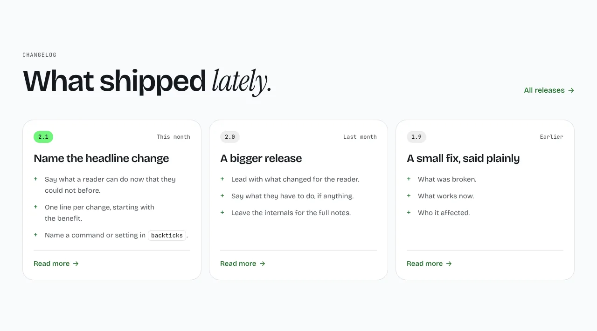
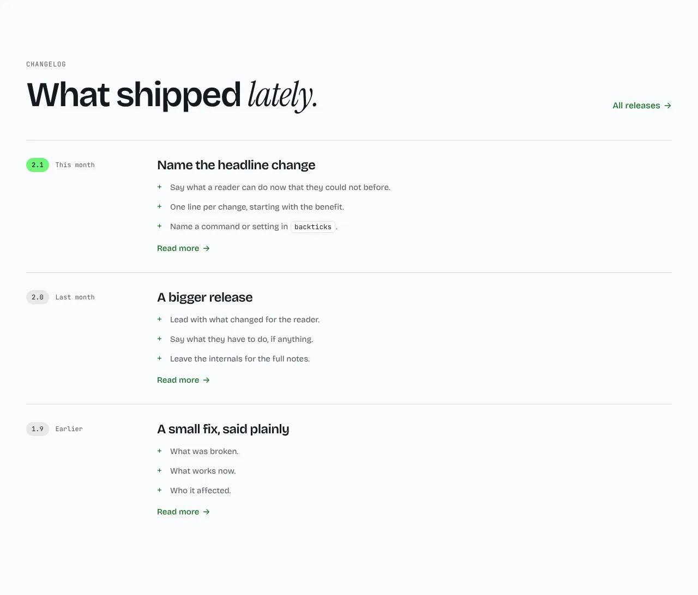

The latest releases, newest first: a version, a title and a few lines on what changed, with a link to the full notes. The first release in the list is the latest, and its version chip takes the accent color. It is content like any other section, so you write the releases yourself: the page says what a release means for a reader, the full notes say the rest.

**`cards`** (default): one card per release, side by side.



**`timeline`**: one release per row, the version and date on the left.



Content: 1 to 6 `releases` of `{ version, date?, ref?, title, items, link? }`, each with 1 to 6 `items`. Optional: `eyebrow`, `heading`, `body` and `link`, the link beside the heading to every release.

- `ref` is a short commit hash or tag, shown beside the version.
- `items` are one line each. Text in backticks shows as code.

## Add it to your site

A new site does not have it. One command adds it: it copies the section and the files it needs, and never overwrites a file you changed.

```sh
npx bearminion add changelog
```

Back to [all sections](README.md). See [The command line](../cli.md) for what `add` does.
