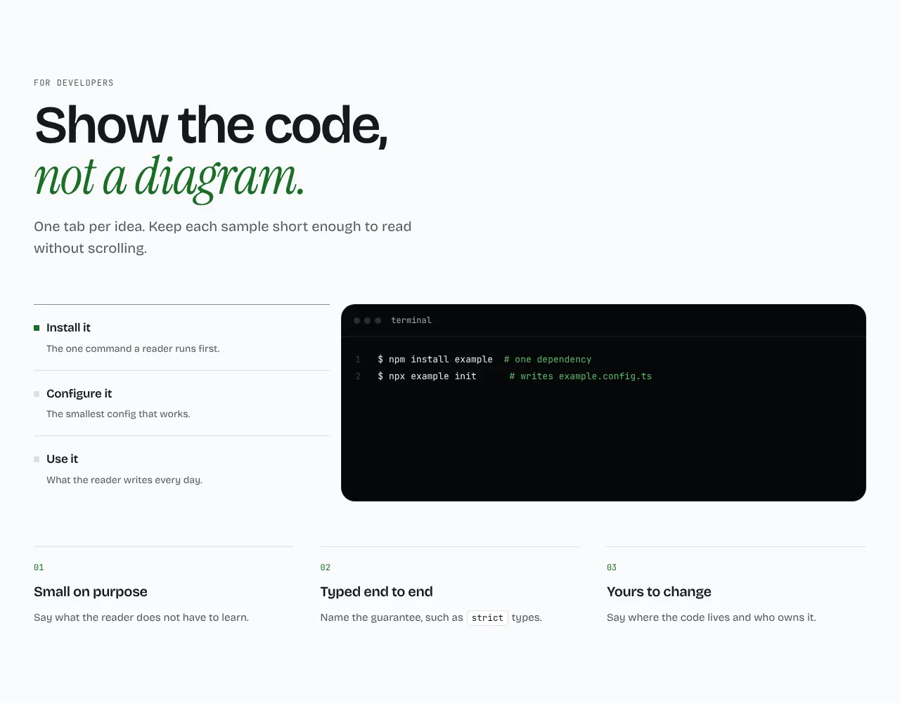
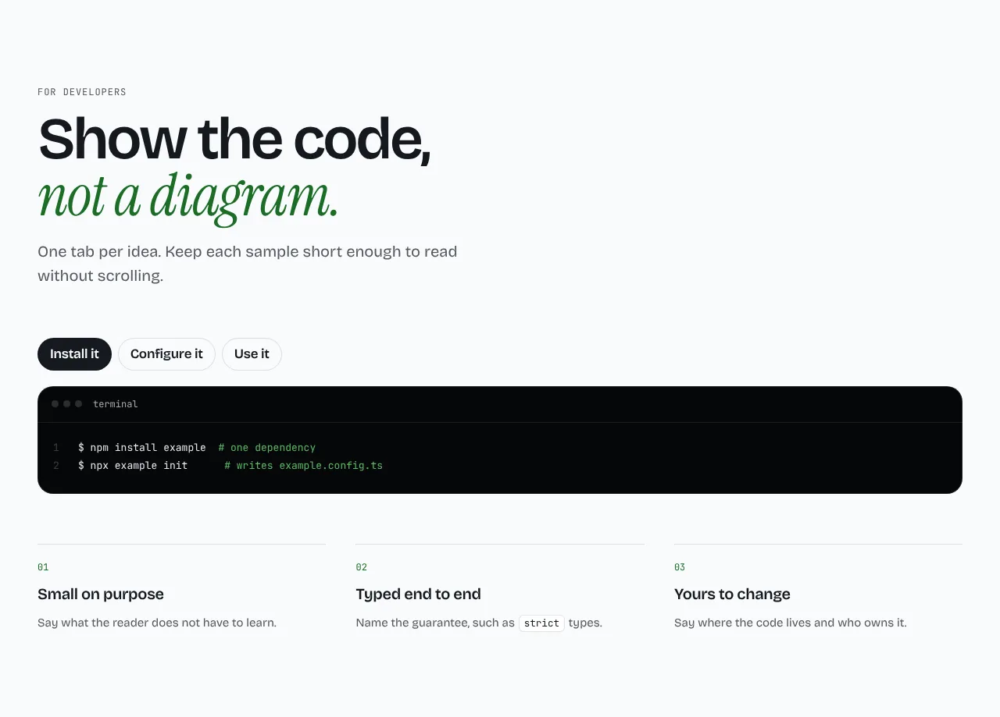

Code samples in tabs, each with a title and a line of explanation, and up to six numbered points under them. For a developer page: show the config, the command and the file, not a diagram of them. The code panel is dark in every tone, like an editor window, and scrolls sideways on a narrow screen.

**`side`** (default): the tabs in a list on the left, with their descriptions, and the code on the right.



**`top`**: the tabs in a row of pills over a full-width code panel.



Content: 2 to 6 `tabs` of `{ title, description?, file?, code }`, and up to six `points` of `{ title, description? }`. Optional: `eyebrow`, `heading`, `body` and `points`.

- `code` is kept as it is written: line breaks and spaces stay. Edit it in the sidebar, where it is a multi-line box.
- A line that starts with `//` or `# `, and the end of a line from two spaces and `// ` or `# ` on, is drawn as a comment, in green. `a#b` and URLs stay code.
- `file` is the name over the code, such as `src/lib/content-model.ts` or `terminal`.
- In `top`, the tab descriptions are not shown; the titles are the pills.

The tabs follow the ARIA tabs pattern: Tab reaches the selected tab, the arrow keys, Home and End move between them, and the code panel can be scrolled from the keyboard.

## Add it to your site

A new site does not have it. One command adds it: it copies the section and the files it needs, and never overwrites a file you changed.

```sh
npx bearminion add code-tabs
```

Back to [all sections](README.md). See [The command line](../cli.md) for what `add` does.
