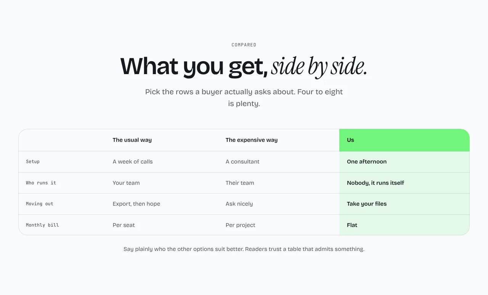
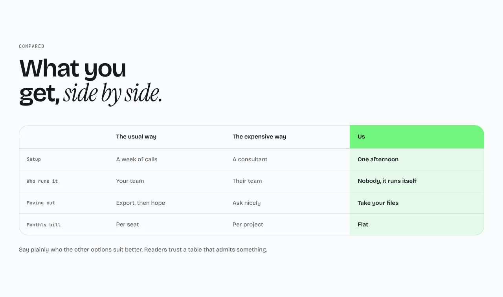

A table of options side by side: one row per thing you compare, one column per option, and your own column highlighted. On a narrow screen the table scrolls sideways instead of squeezing its cells, and the keyboard can scroll it too.

**`centered`** (default): the heading centered over the table, the note centered under it.



**`left`**: the heading on the left with the body beside it.



Content: 2 to 5 `columns` of `{ label, highlight }` and up to 12 `rows` of `{ label, values }`. Optional: `eyebrow`, `heading`, `body` and `note`.

- Every row has one value per column, in the columns' order. A row with a value too many or too few is refused, with the row named, so add or remove a value in every row when you add or remove a column.
- `highlight` on a column fills its header with the accent color and tints its cells. Use it for one column: yours.
- `note` is a line under the table, for the caveat. A comparison that admits what the others do better reads as fair.

## Add it to your site

A new site does not have it. One command adds it: it copies the section and the files it needs, and never overwrites a file you changed.

```sh
npx bearminion add compare
```

Back to [all sections](README.md). See [The command line](../cli.md) for what `add` does.
