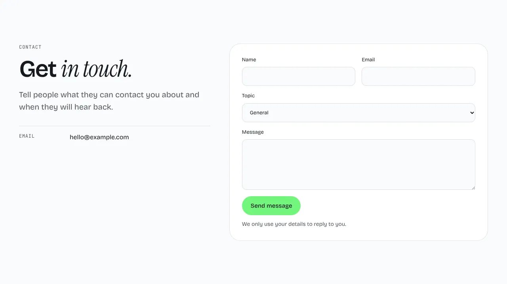
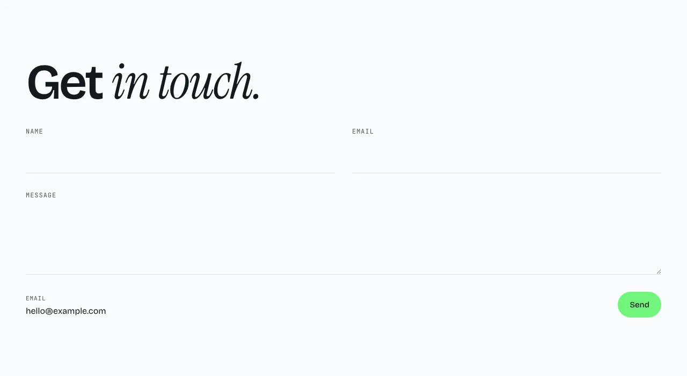

Contact details beside a form.

The form always posts to `/api/contact`, where a handler you write in `src/forms/contact.ts` receives the message. Its keys, including the Cloudflare Turnstile site key (`PUBLIC_TURNSTILE_SITE_KEY`), live in the environment, not in the content file. While that file does not exist, `astro dev` and `astro build` warn, the section's settings in the editor warn, and visitors who send the form get an error. [Forms](../forms.md) covers the handler, the glue for your host, form services, email, Turnstile and spam.

**`split`** (default): the heading and details on the left, the form on the right.



**`card`**: a centered heading over a form in a card.


**`minimal`**: a large heading and a form with underlined fields.



Content: `details` (a `label` and a `value` each, such as an email address) and `topics` (the choices in the topic menu), three of each recommended. Optional: `eyebrow`, `heading`, `body`, `note` and `thanks`. When the handler answers with a `message`, the visitor sees it in place of `thanks`. A failed send shows its error in a message at the bottom of the screen that stays until the visitor closes it.

## Add it to your site

A site made before this section existed gets it with one command. It copies the section and the files it needs, and never overwrites a file you changed.

```sh
npx bearminion add contact
```

Back to [all sections](README.md). See [The command line](../cli.md) for what `add` does.
