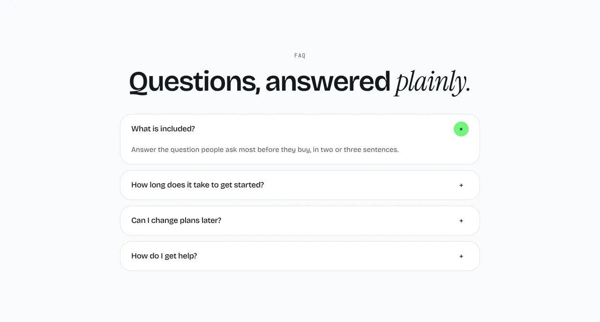
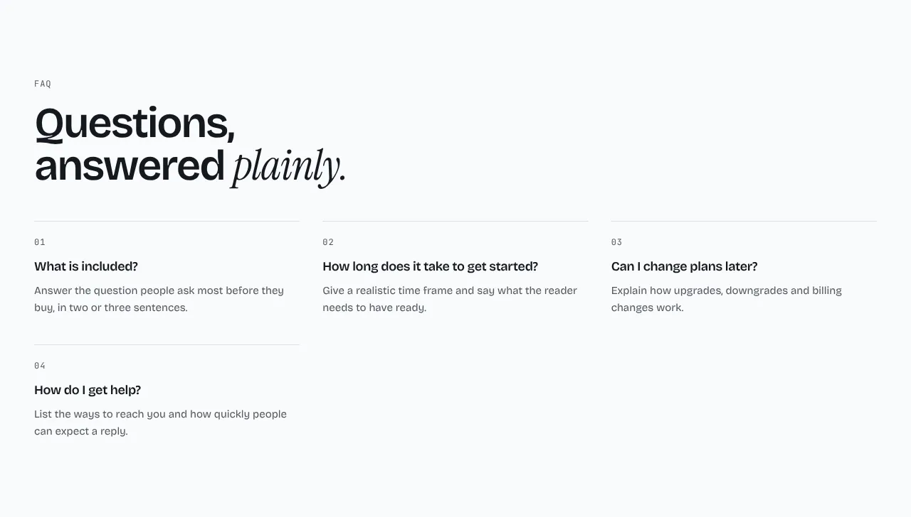

Questions that open to show their answers.

**`accordion`** (default): a centered stack of questions, one open at a time.

**`split`**: the heading and a link on the left, the questions on the right.

**`grid`**: every question with its answer showing, in columns.

Content: 4 to 8 `items` of `{ question, answer }`. Optional: `eyebrow`, `heading`, `more` and `link`.

Back to [all sections](README.md). Add it to a site made earlier with `npx bearminion add faq`.
