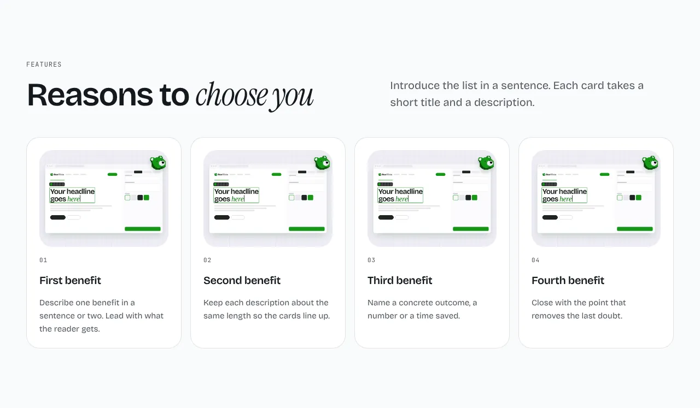
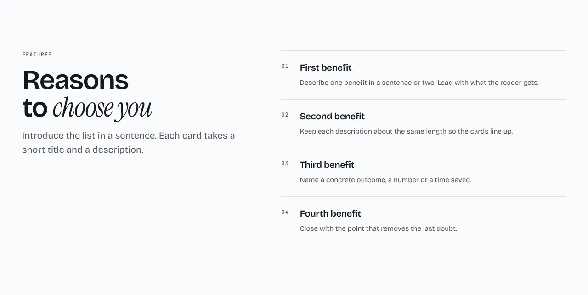
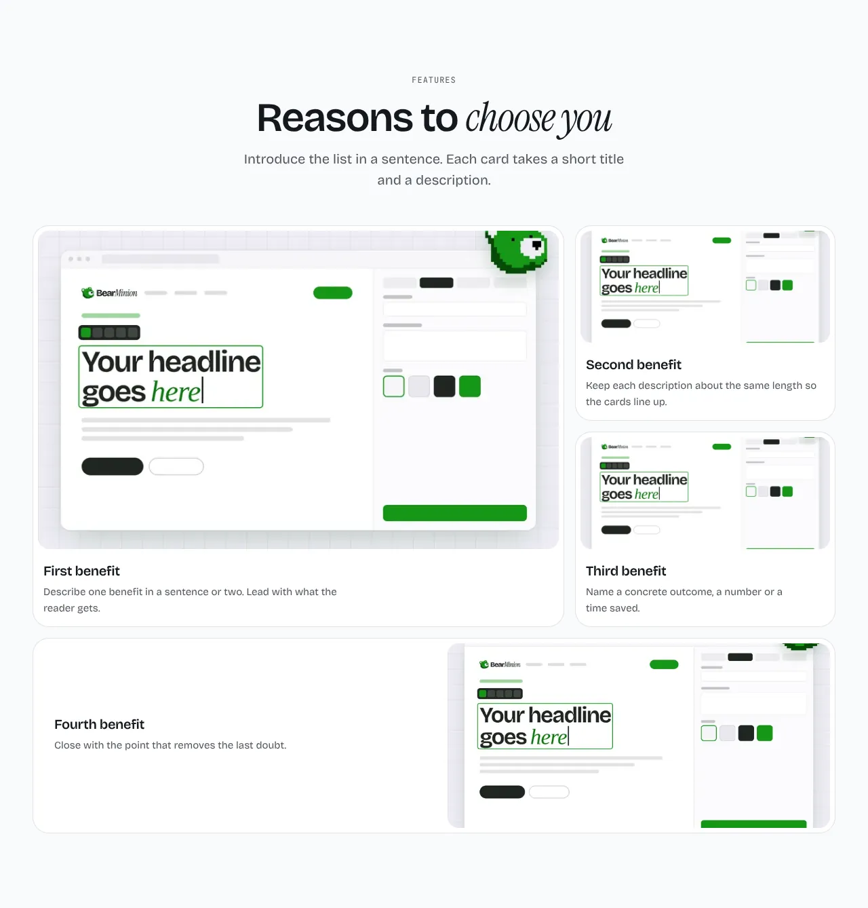

Cards with a title, a description and an optional picture.

**`cards`** (default): the items as cards in a row.

**`list`**: the heading on the left, the items as a numbered list on the right.

**`bento`**: one large card beside smaller ones. Four or six items fill the grid best.

Content: 3 to 6 `items`, each with a `title`, an optional `description` and an optional `image`. Optional: `eyebrow`, `heading`, `intro` and `link`.

Back to [all sections](README.md). Add it to a site made earlier with `npx bearminion add features`.
