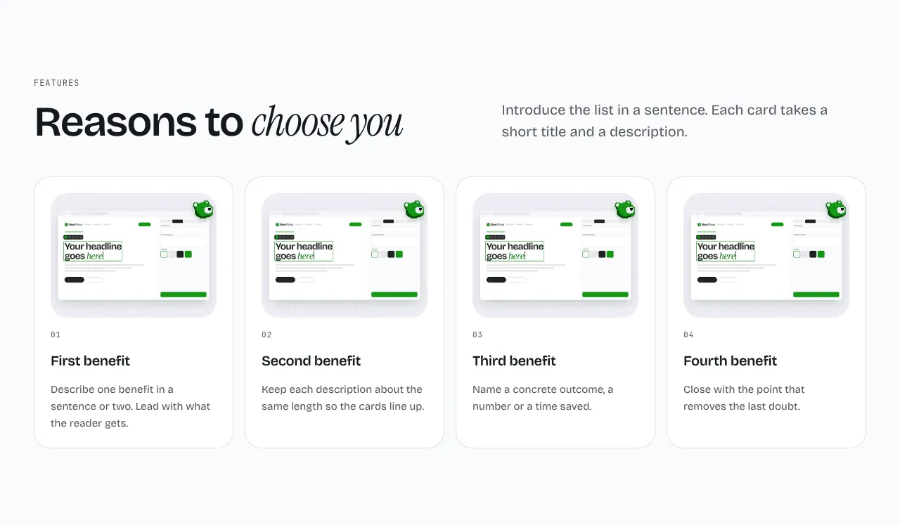
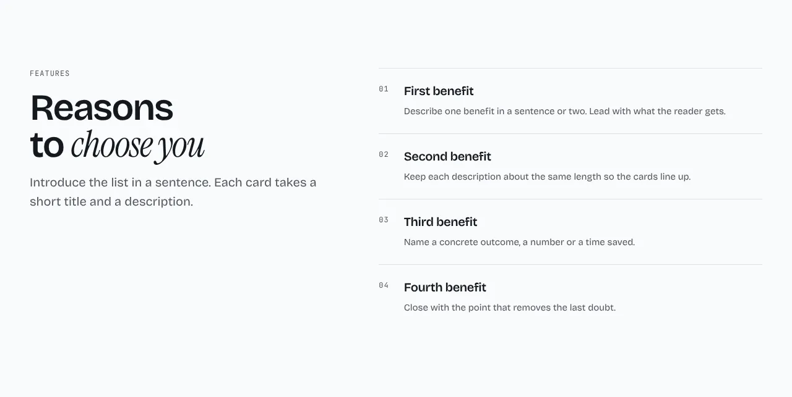
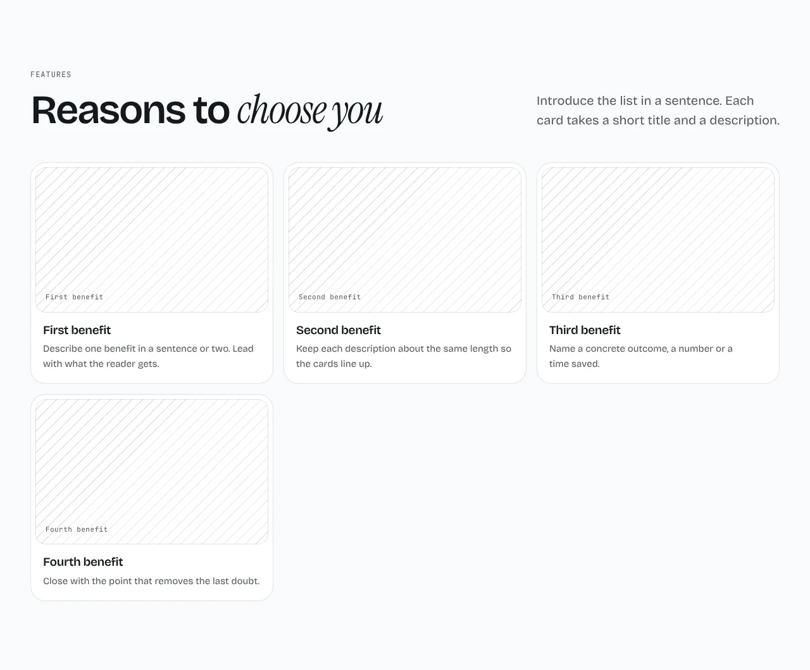

Cards with a title, a description and an optional picture.

**`cards`** (default): the items as cards in a row.



**`list`**: the heading on the left, the items as a numbered list on the right.



**`bento`**: one large card beside smaller ones. Four or six items fill the grid best.


**`screens`**: a picture on top of every card at the same 16:10, made for screenshots. Six items fill two rows of three.



Content: 3 to 6 `items`, each with a `title`, an optional `description` and an optional `image`. Optional: `eyebrow`, `heading`, `intro` and `link`.

## Add it to your site

A new site has it. A site made before this section existed, or before the `screens` layout, gets it with one command. It copies the section and the files it needs, and never overwrites a file you changed.

```sh
npx bearminion add features
```

Back to [all sections](README.md). See [The command line](../cli.md) for what `add` does.
