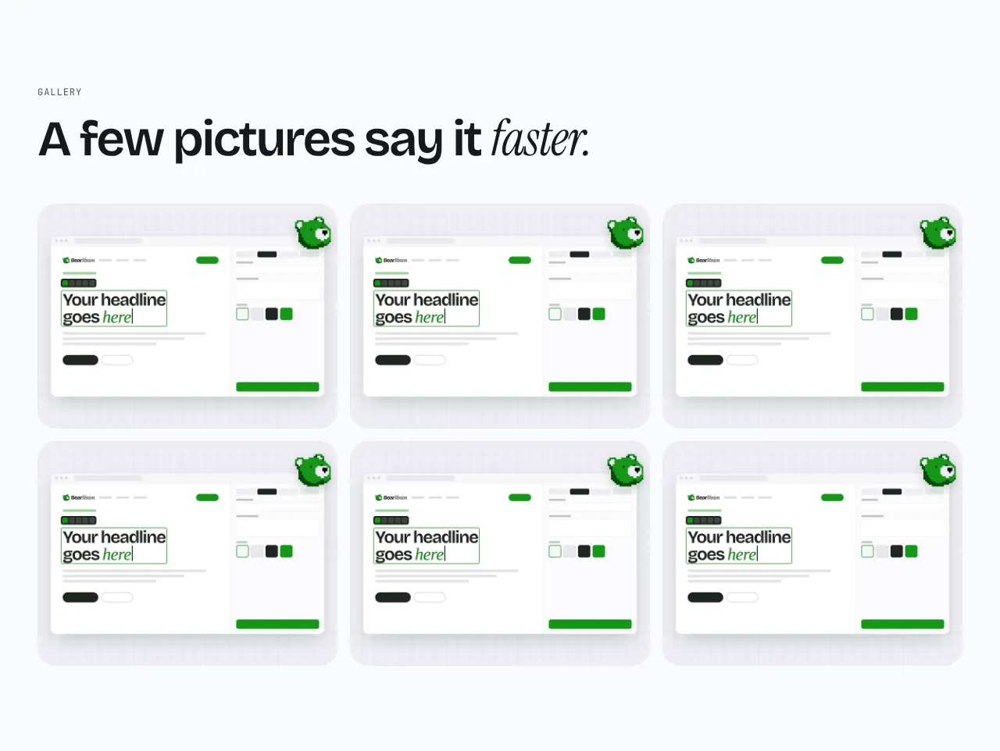
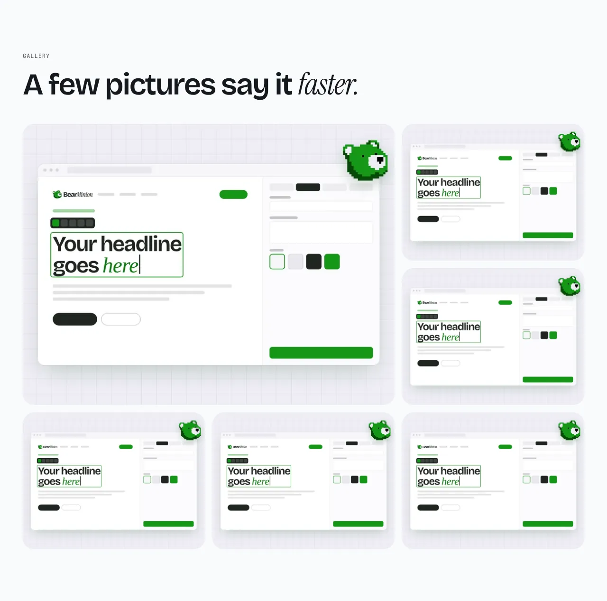

A set of pictures. Clicking one opens it large in a lightbox, with its caption, previous and next buttons, arrow keys and swipe. With JavaScript off, each picture links to its large file. While the editor is on the page, a click edits the picture instead.

**`grid`** (default): uniform crops in rows.



**`masonry`**: columns that keep each picture's own proportions.


**`featured`**: the first picture large, the rest beside and below it.



Options:

- **Pictures per row** (`columns`): `2`, `3` (default) or `4`. Fewer on narrow screens.
- **Open pictures large on click** (`lightbox`, on by default).
- **Draw a box around each picture** (`frame`, off by default): a bordered box, so a picture that does not fill its frame still shows where the frame ends.

Content: 1 to 24 `images`, 6 to 12 recommended. Each needs alt text. An optional `caption` shows under the picture in the lightbox; a picture without one shows its alt text there. Optional: `eyebrow`, `heading` and `body`.

## Add it to your site

A site made before this section existed gets it with one command. It copies the section and the files it needs, and never overwrites a file you changed.

```sh
npx bearminion add gallery
```

Back to [all sections](README.md). See [The command line](../cli.md) for what `add` does.
