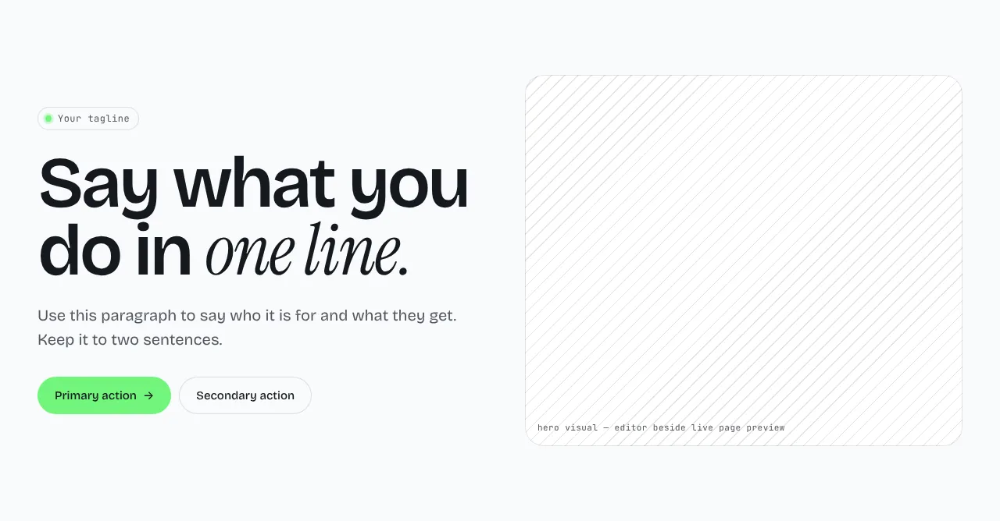
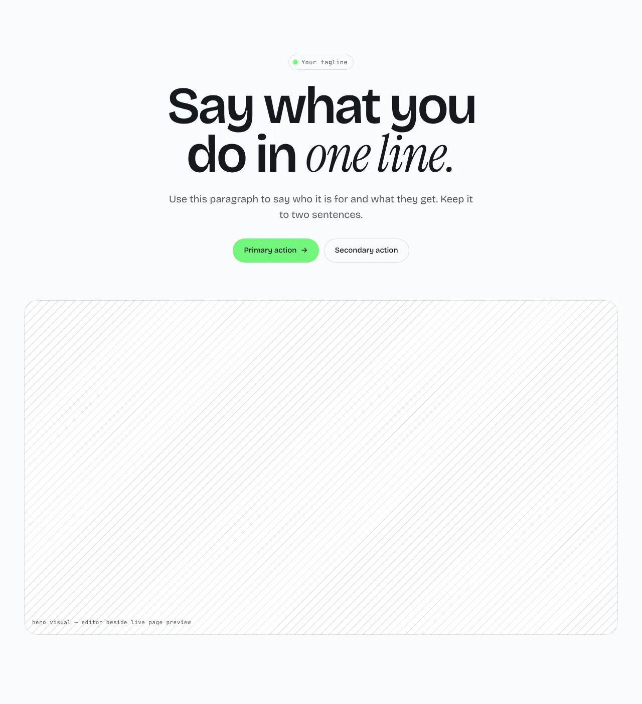
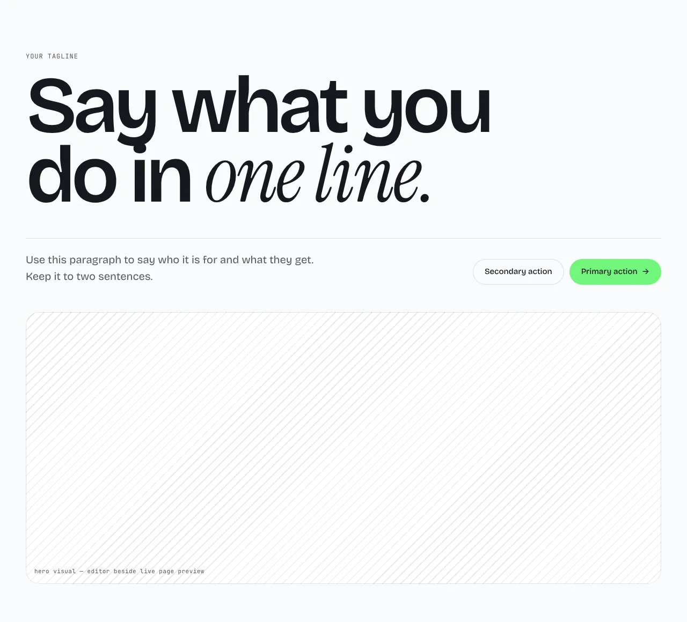

The opening heading, a short intro, up to two buttons and a picture. Put it first on a page.

**`split`** (default): text on the left, the picture on the right.



**`centered`**: everything centered, with a wide picture under the buttons.



**`editorial`**: an oversized heading, then the intro and the buttons side by side under a rule, with the picture below.



Options:

- **Primary button** (`button`, on by default): turn it off to hide the primary button.
- **Install command** (`code`): `off`, `action` (a copy button in the button row, in place of the secondary button), `chip` or `terminal`. It shows the `command` text.
- **Background glow** (`glow`, off by default).

Content, all optional: `eyebrow`, `heading`, `sub`, `badge` (`tag`, `text`, `href`; it takes the eyebrow's place in `split` and `centered`), `primary`, `secondary`, `command` and `image`.

## Add it to your site

A site made before this section existed gets it with one command. It copies the section and the files it needs, and never overwrites a file you changed.

```sh
npx bearminion add hero
```

Back to [all sections](README.md). See [The command line](../cli.md) for what `add` does.
