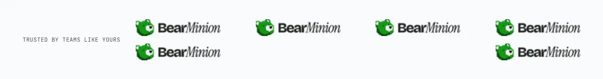

A row of customer or partner logos under a small label. Each logo needs alt text.

**`row`** (default): the logos in one row beside the label, wrapping on narrow screens.

**`grid`**: the logos in a ruled grid.

**`marquee`**: the logos scroll sideways in a loop, and pause while the pointer is over them or focus is inside.

Content: `label` (optional) and `logos`, six recommended.

Back to [all sections](README.md). Add it to a site made earlier with `npx bearminion add logo-strip`.
