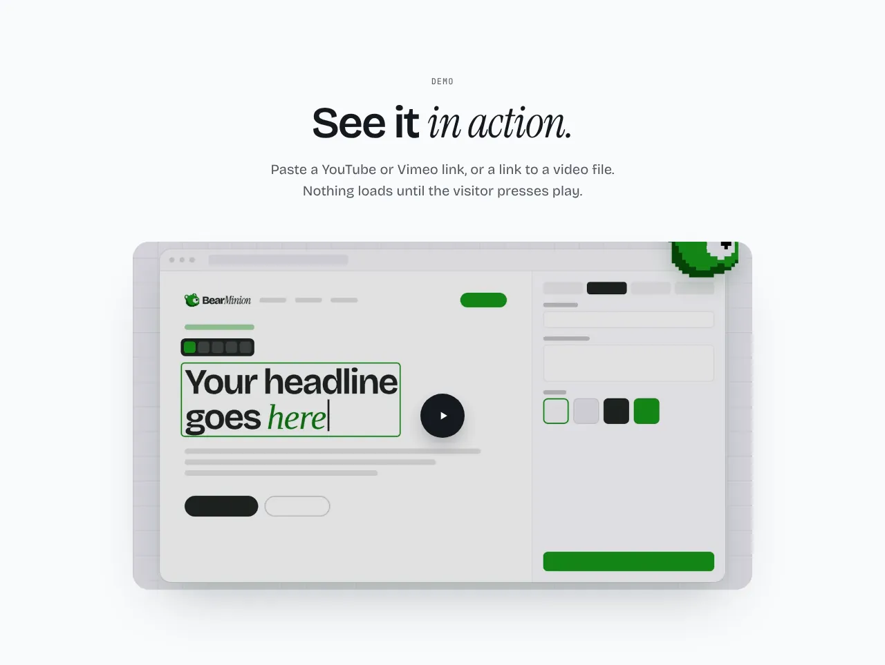
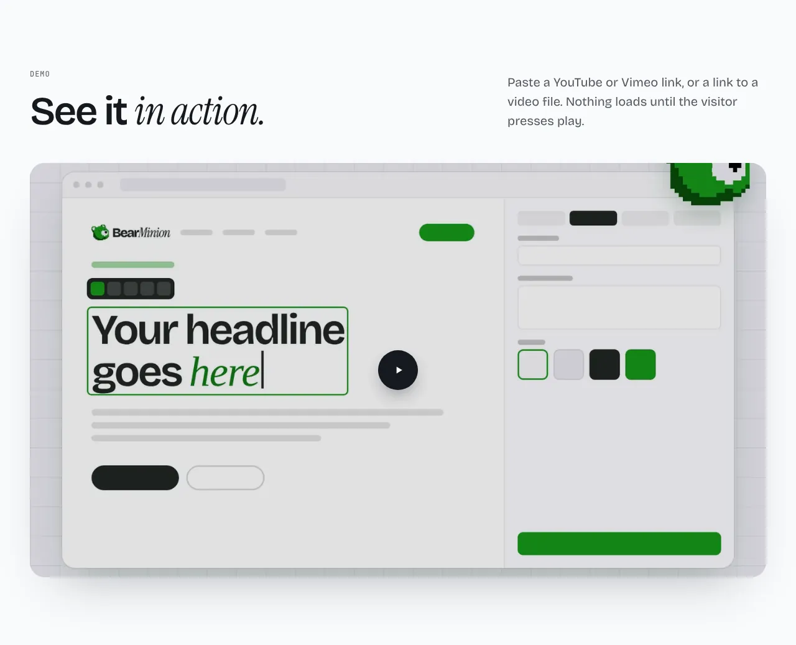
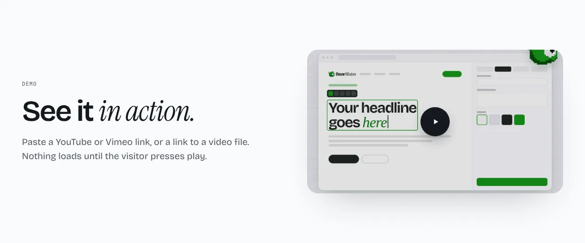

One video or one image under a heading. A video can be a YouTube or Vimeo link or a link to a video file. YouTube and Vimeo load nothing until the visitor presses play, and go through `youtube-nocookie.com` and Vimeo with Do Not Track. A YouTube video without a poster shows its own thumbnail. An empty media frame is a hint in the editor: a built site leaves it out.

**`centered`** (default): heading and text centered above the frame.



**`wide`**: the heading and text side by side above a wide frame.



**`split`**: the text on the left, the frame on the right.



Options:

- **Type** (`kind`): `video` (default) or `image`.
- **Shape** (`aspect`): `16:9` (default), `4:3`, `21:9` or `1:1`.
- **Video playback** (`playback`): `controls` (default), or `loop` for a video file. A looping video is muted, plays while it is on screen, and stays paused with reduced motion.
- **Show heading** (`intro`, on by default).

Content, all optional: `eyebrow`, `heading`, `body`, `video`, `poster`, `image`, `label` and `caption`. The editor's **Video** field takes a link or a path, and can upload a video file to `public/videos`. See [The editor](../editor.md#videos).

Older sites had a separate Video section. Content version 2 turns it into Media when the file is next saved.

## Add it to your site

A site made before this section existed gets it with one command. It copies the section and the files it needs, and never overwrites a file you changed.

```sh
npx bearminion add media
```

Back to [all sections](README.md). See [The command line](../cli.md) for what `add` does.
