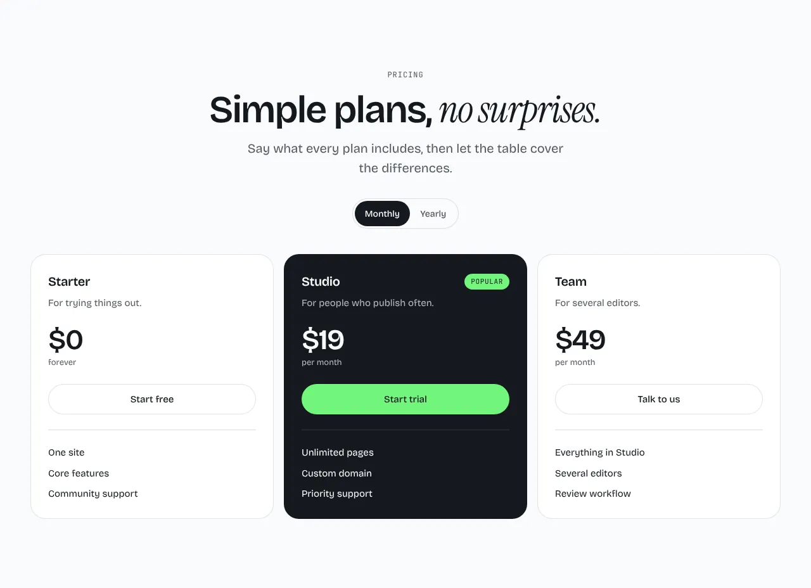
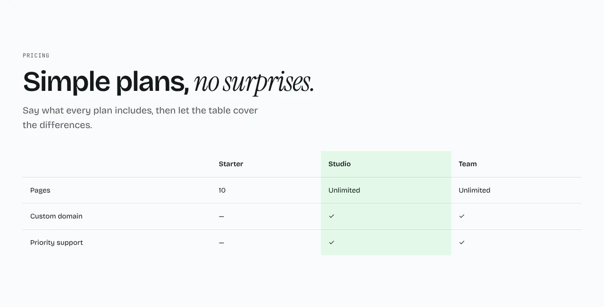
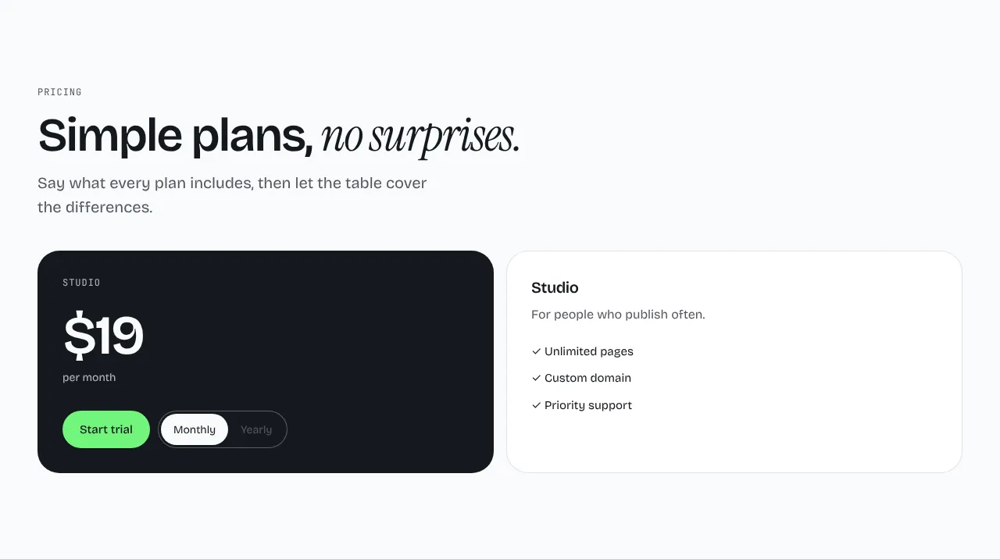

Plans side by side, with one highlighted and a monthly and yearly switch.

**`tiers`** (default): each plan as a card, the featured one in dark.



**`table`**: a comparison table. It reads the section's `rows`: a label, then one value per plan, where a value is text or a tick.



**`single`**: the featured plan large, with its features beside it.



Options: **Yearly discount** (`yearlyDiscount`): a number from 0 to 1, `0.2` by default.

Content: `plans` of `{ name, blurb?, monthly, featured?, cta?, features }`, three recommended. A plan's `cta` is a link `{ label, href }`. Optional: `rows`, `eyebrow`, `heading`, `intro` and `singleHeading`.

## Add it to your site

A site made before this section existed gets it with one command. It copies the section and the files it needs, and never overwrites a file you changed.

```sh
npx bearminion add pricing
```

Back to [all sections](README.md). See [The command line](../cli.md) for what `add` does.
