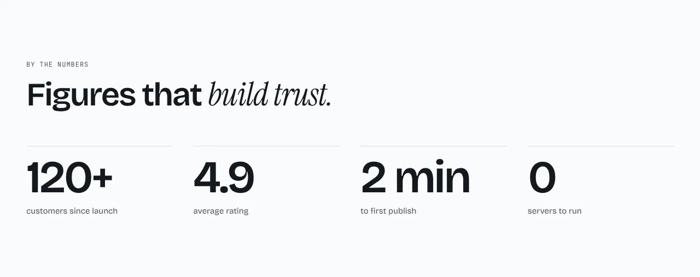
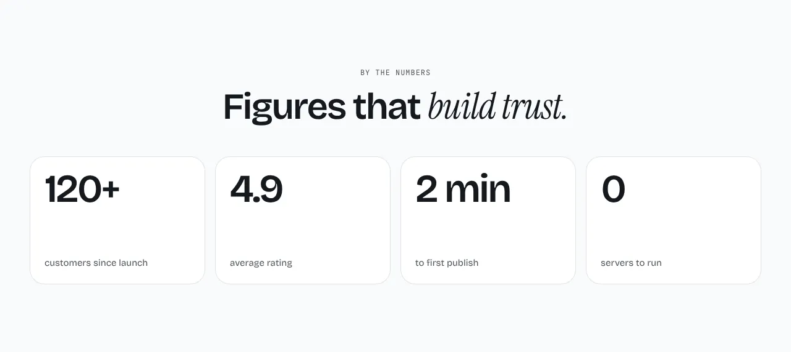
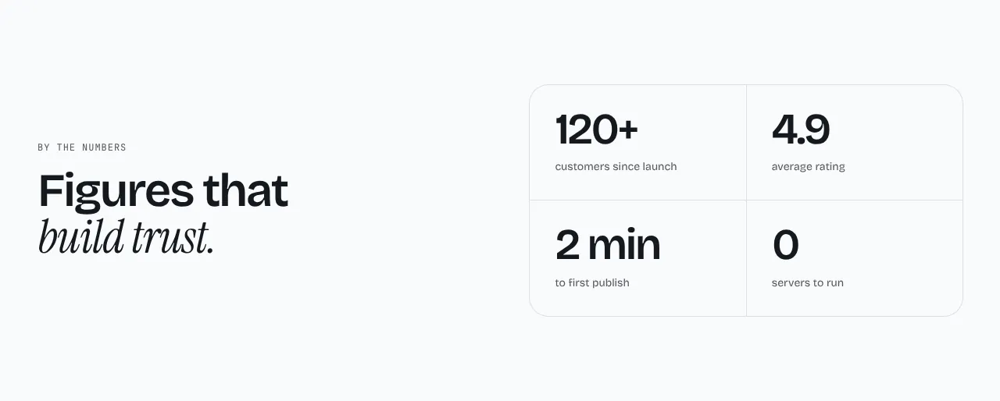

Big numbers with a short label under each.

**`row`** (default): the numbers in a ruled row.



**`cards`**: each number in its own card.



**`split`**: the heading on the left, the numbers in a grid on the right.



Content: `items` of `{ value, label? }`, four recommended. Optional: `eyebrow`, `heading` and `body`.

## Add it to your site

A site made before this section existed gets it with one command. It copies the section and the files it needs, and never overwrites a file you changed.

```sh
npx bearminion add stats
```

Back to [all sections](README.md). See [The command line](../cli.md) for what `add` does.
