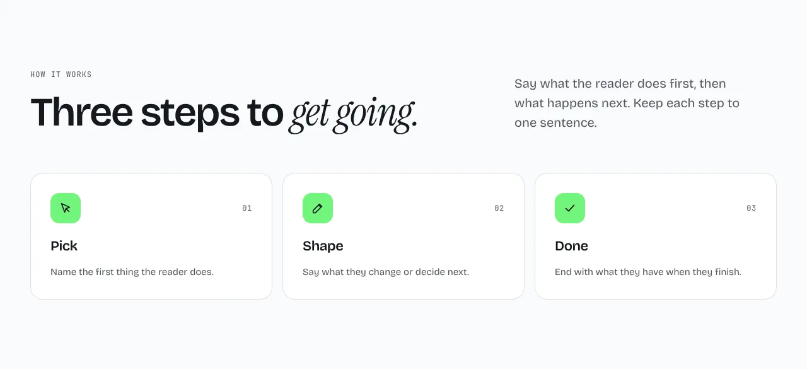
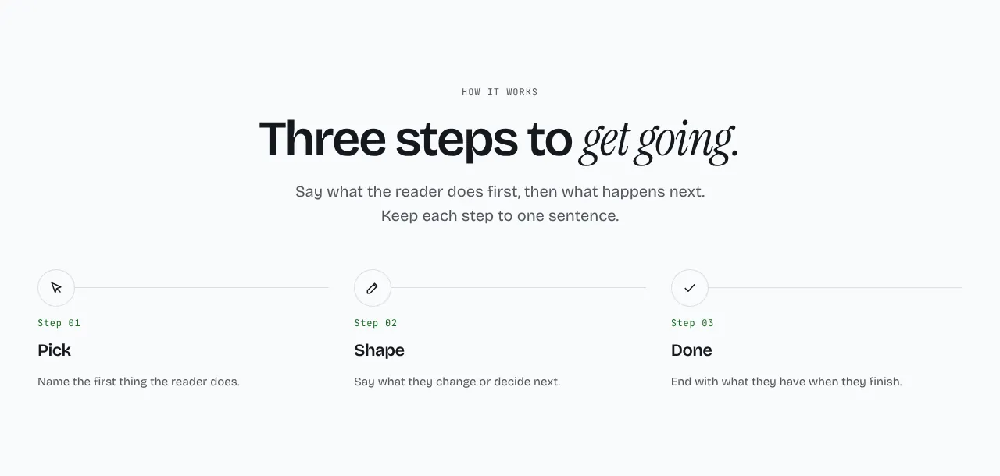
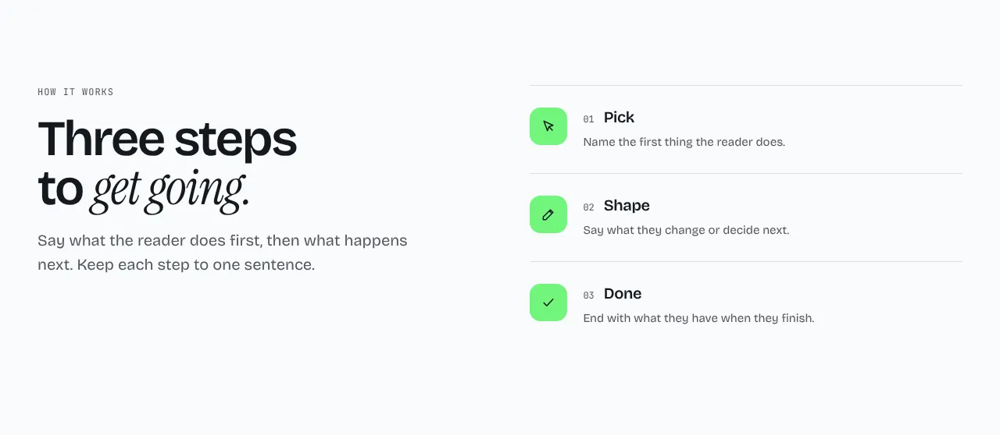
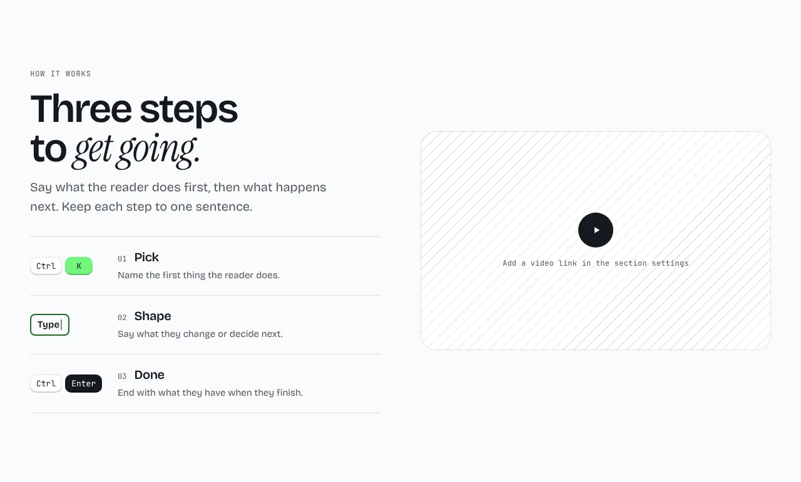
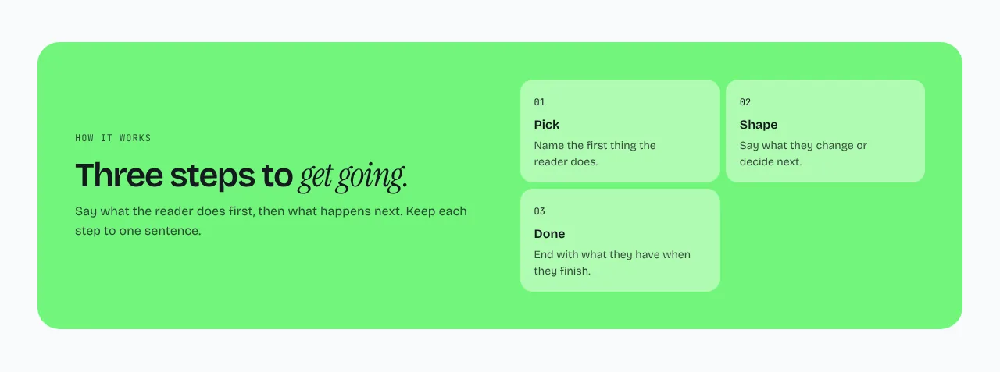

A few short points, each with an icon, a title and a description. Use it for steps or for reasons.

**`columns`** (default): the steps as cards side by side.



**`rail`**: a centered heading, with the steps along a thin line.



**`list`**: the heading on the left, the steps as a numbered list on the right.



**`keys`**: the steps as rows with a keyboard shortcut or a typed word in front of each, and a video beside them. For "how it works": what the reader presses, in order.



**`panel`**: the heading and the steps together on an accent panel, the steps as numbered tiles. A call-out between other sections, with less space above and below it.



Options: **Show numbers** (`numbered`, on by default).

Content: 2 to 6 `steps`, 3 or 4 recommended, each with an `icon` (`terminal`, `edit`, `upload`, `moon`, `git`, `check`, `bolt`, `cursor`, `sliders` or `database`), a `title` and an optional `description`. Optional: `eyebrow`, `heading`, `body` and `link`.

The `keys` layout reads more:

- `keys` on a step: keys joined by `+`, such as `Ctrl+E`, are drawn as keycaps, and the last key of each shortcut takes the accent and the text color in turn. A single word, such as `Click`, is drawn as a word being typed. A step without `keys` shows its icon.
- `video`: a YouTube or Vimeo link, or a video file, as in the [Media](media.md) section. It loads nothing until the visitor presses play. `poster` is the cover until then, `caption` a line under it and `duration` its length, such as `0:25`. Without a video the steps take the full width; the editor shows an empty frame where the video goes.

The editor shows `keys`, `video`, `poster`, `caption` and `duration` only while the layout is `keys`; the other layouts leave them out.

## Add it to your site

A new site has it. A site made before this section existed, or before the `keys` and `panel` layouts, gets it with one command. It copies the section and the files it needs, and never overwrites a file you changed.

```sh
npx bearminion add steps
```

Back to [all sections](README.md). See [The command line](../cli.md) for what `add` does.
