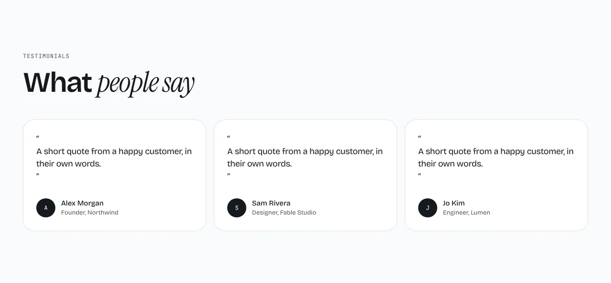
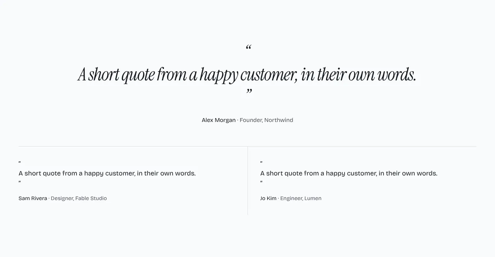

Quotes with a name, a role and an optional avatar.

**`grid`** (default): the quotes as cards in columns.



**`featured`**: one large quote, with the others in a row below.



**`carousel`**: one quote at a time, with a portrait, a counter and previous and next buttons.


Content: `items` of `{ quote, name, role?, image? }`, three recommended. Optional: `eyebrow` and `heading`.

## Add it to your site

A site made before this section existed gets it with one command. It copies the section and the files it needs, and never overwrites a file you changed.

```sh
npx bearminion add testimonials
```

Back to [all sections](README.md). See [The command line](../cli.md) for what `add` does.
