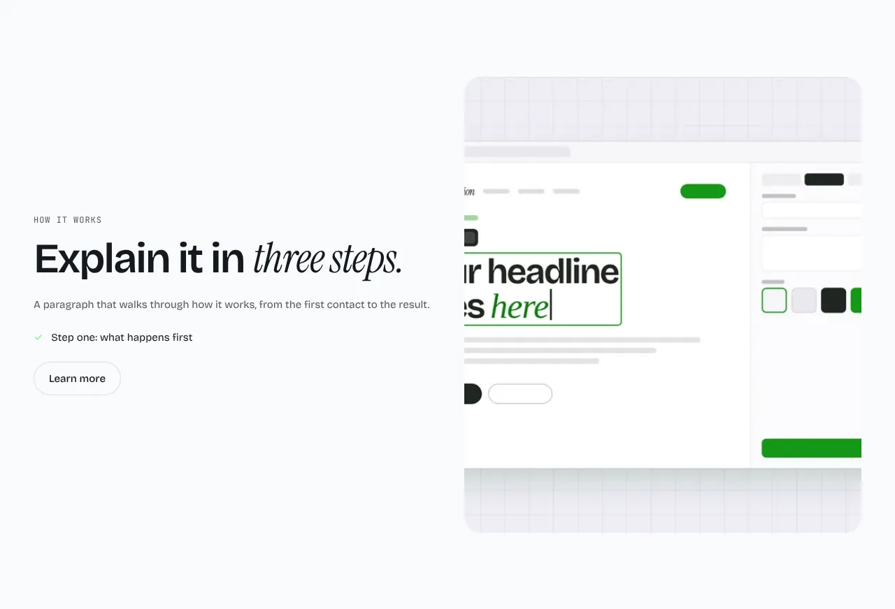
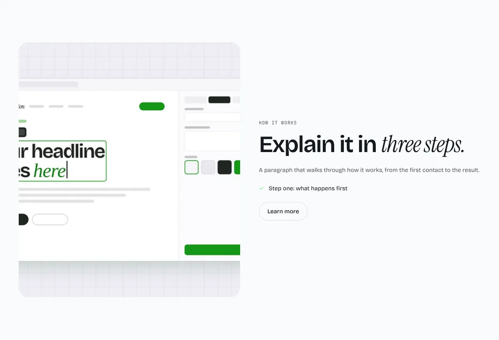
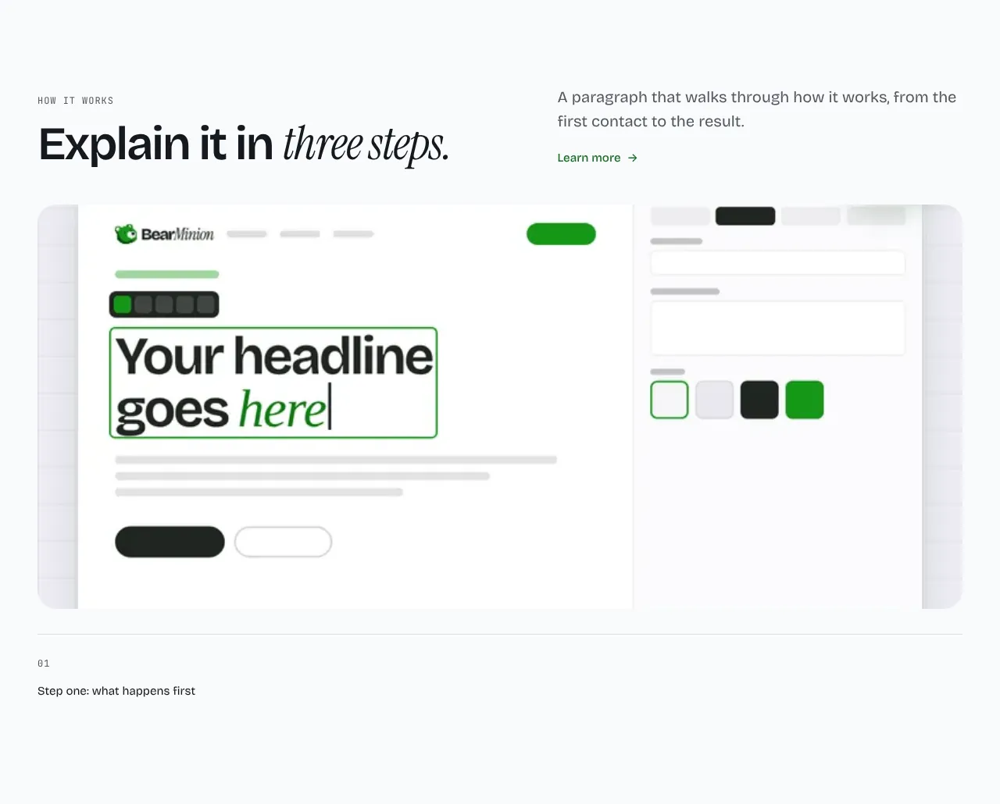

Text beside a picture, with a short list of points and a link.

**`right`** (default): text on the left, the picture on the right.

**`left`**: the picture on the left.

**`wide`**: the text above, with a full-width picture below.

Content: `points` (three recommended), an `image`, optional `eyebrow`, `heading`, `body` and `link`.

Back to [all sections](README.md). Add it to a site made earlier with `npx bearminion add text-image`.
